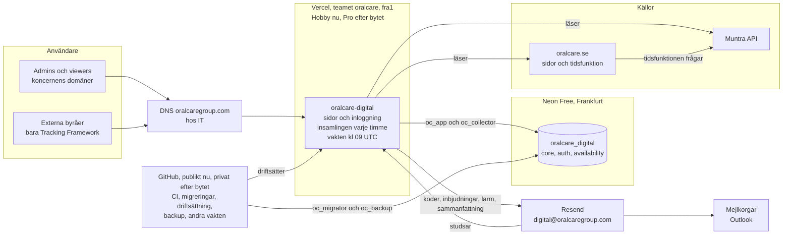

# Oral Care Digital: byggspecifikation

Version 6.2, 2026-10-31. Ägare: Digital, Oral Care Group. Status: för godkännande. Inget är byggt. Dokumentet innehåller inga personuppgifter, eftersom repot är publikt i början.

Det här dokumentet beskriver exakt allt appen ska göra: sidor, regler, insamling, jobb, mejl, databas, inloggning, säkerhet, kodstruktur, tester, inställningar och steg. Utseendet följer prototypen, som finns lokalt (avsnitt 13.4). Prototypen är bara underlag för utseende och innehåll. Koden byggs från grunden.

**Beslut som redan är tagna**

| Beslut            | Innehåll                                                                                                                                          |
| ----------------- | ------------------------------------------------------------------------------------------------------------------------------------------------- |
| Namn              | Oral Care Digital, `digital.oralcaregroup.com`, repot `oralcare-digital`                                                                          |
| Drift i två faser | Nu: Vercel Hobby och publikt repo. Om cirka två veckor: Vercel Pro och privat repo på GitHub Team. Koden är densamma i båda faserna (avsnitt 2.1) |
| Användare         | Inga exempelanvändare. Vid start finns bara du, som admin                                                                                         |
| Sidor             | Som i prototypen. Changes, Issues, Methodology, Data quality och en egen Muntra-vy byggs inte                                                     |
| Bara fakta        | Sidor och mejl visar bara det som hämtas från oralcare.se och Muntra. Inga gissade orsaker                                                        |
| Senare            | Export, fler filter och ett admin-gränssnitt för gränserna (avsnitt 21)                                                                           |
| Moduler           | Bara Availability byggs nu. Övriga moduler är Coming soon. NPS och bokningsdata ligger hos Impact och importeras därifrån när de modulerna byggs  |

---

## 1. Vad som byggs

- **Webbappen Oral Care Digital** på `https://digital.oralcaregroup.com`, på engelska.
- **Modulen Availability:** de lediga tider patienterna kan boka på oralcare.se, jämfört med det Muntra publicerar för onlinebokning, över tid, per marknad, region, klinik och behandling.
- **Insamlingen:** mäter varannan timme kl 06-22 svensk tid och sparar allt över tid, eftersom historik inte kan tas fram i efterhand.
- **Inloggning** med engångskod via mejl, och användare med vyer, marknader och roll.
- **Coming soon-sidor** för Booking statistics, NPS, Funnel, Tracking Framework och Monitoring, så att menyn och behörigheterna per vy fungerar från start.
- **Fyra mejl:** inloggningskod, inbjudan, larm och daglig sammanfattning.
- **Drift:** nu Vercel Hobby och ett publikt repo, efter bytet Vercel Pro och GitHub Team. Neon Free och Resend Free i båda faserna.

**Marknader:** Sverige, Norge, Danmark och Nederländerna finns i appen från start. Bara Sverige mäts nu, eftersom insamlingen läser Muntra. Övriga marknader visar "No data yet" tills de har en källa.

---

## 2. Namn, konton och adresser

| Vad            | Namn                                                                                                             |
| -------------- | ---------------------------------------------------------------------------------------------------------------- |
| Webbapp        | Oral Care Digital                                                                                                |
| Adress         | `https://digital.oralcaregroup.com`                                                                              |
| Repo           | `oral-care/oralcare-digital` på GitHub. Publikt nu, privat efter bytet                                           |
| Lokal mapp     | `Oral Care Dev/oralcare-digital`, bredvid `oralcare` och `oralcare-sanity`                                       |
| Vercel-team    | `oralcare`. Hobby nu, Pro efter bytet                                                                            |
| Vercel-projekt | `oralcare-digital`, med funktionsregion `fra1` (Frankfurt). Appen, insamlingen och vakten ligger i samma projekt |
| Neon-projekt   | `oralcare-digital`, region `aws-eu-central-1` (Frankfurt)                                                        |
| Databas        | `oralcare_digital` på grenen `main`. Understreck, eftersom Postgres-namn med bindestreck måste citeras           |
| Databasroller  | `oc_migrator`, `oc_collector`, `oc_app` och `oc_backup` (avsnitt 10.4)                                           |
| Scheman        | `core`, `auth` och `availability`. Senare moduler får egna scheman, till exempel `nps`                           |
| Mejlavsändare  | Oral Care Group – Digital `<digital@oralcaregroup.com>` via Resend                                               |
| Svar på mejl   | Brevlådan `digital@oralcaregroup.com`                                                                            |

### 2.1 Drift nu och efter bytet

Appen byggs från början för Vercel Pro och ett privat repo, men driftsätts först på Vercel Hobby med ett publikt repo. Koden är densamma i båda faserna. Bytet ändrar bara cron-raderna i `vercel.json`, en inställning i databasen och inställningarna hos Vercel och GitHub (avsnitt 16.3).

| Del                               | Nu: Hobby och publikt repo                                                                                                                                         | Efter bytet: Pro och privat repo                                                      |
| --------------------------------- | ------------------------------------------------------------------------------------------------------------------------------------------------------------------ | ------------------------------------------------------------------------------------- |
| Vercel                            | Hobby                                                                                                                                                              | Pro, betalas av IT                                                                    |
| GitHub                            | Free, publikt repo                                                                                                                                                 | Team, privat repo, betalas av IT                                                      |
| Cron för mätningen                | 19 cron-jobb per marknad, ett per hel timme kl 04-22 UTC, vart och ett en gång per dygn, eftersom Hobby bara tillåter ett anrop per jobb och dygn. Nu bara Sverige | Ett cron-jobb per marknad, varje hel timme kl 04-22 UTC                               |
| Cron för vakten                   | Två cron-jobb, kl 09 och 10 UTC                                                                                                                                    | Ett cron-jobb, kl 09 och 10 UTC                                                       |
| När cron startar                  | Någon gång under timmen                                                                                                                                            | På minuten                                                                            |
| Vercels gränser                   | Hobbys månadsgränser, som delas av hela teamet. När en tar slut stannar funktionerna i upp till 30 dagar. Vakten följer insamlingens CPU-tid mot 4 CPU-timmar      | Spend Management mejlar vid 50, 75 och 100 procent av en månadsgräns som IT bestämmer |
| Vercels loggar                    | Sparas en timme                                                                                                                                                    | Sparas längre, men körloggen i databasen gäller ändå                                  |
| Loggar och filer i GitHub Actions | Kan läsas av alla med ett GitHub-konto. Backupen är krypterad och loggarna innehåller aldrig data                                                                  | Bara de som har åtkomst till repot                                                    |
| Schemalagda jobb i GitHub         | Stängs av efter 60 dagar utan ändringar i repot. Vakten larmar när backupen är äldre än 26 timmar                                                                  | Stängs inte av                                                                        |
| Hemlighetsskanning                | GitHubs push protection, gratis för publika repon, och gitleaks                                                                                                    | gitleaks, och GitHubs Secret Protection om IT köper det                               |
| Driftsättning                     | GitHub Actions med `vercel deploy`. Hobby kan blockera en commit-författare som inte är teamets ägare, och det testas först av allt i steg 1                       | Samma arbetsflöde, utan den begränsningen                                             |
| Kostnad                           | 0 kr                                                                                                                                                               | Vercel Pro och GitHub Team, som IT betalar                                            |

---

## 3. Användare och behörighet

### 3.1 Vem som kommer in

- **Bara inbjudna.** Ingen kan skapa ett konto själv.
- **Koncernens domäner:** `oralcare.se` (Sverige), `octannklinikker.no` (Norge), `oralcare.dk` (Danmark) och `oralcare.nl` (Nederländerna). Listan ligger i koden och bekräftas av IT i steg 3.
- **Externa byråer** kan bjudas in med en adress utanför koncernens domäner, men bara till Tracking Framework. Ett sådant konto kan aldrig få en vy med data om kliniker eller patienter. Det kontrolleras när inbjudan skapas, vid varje anrop och av en regel i databasen.
- **Andra adresser** får samma svar som inbjudna, men ingen kod. Då kan ingen skicka koder till påhittade adresser.

### 3.2 Användarna vid start

- **Inga exempelanvändare.** Vid start finns bara du. Ditt konto skapas en gång med SQL i Neons SQL Editor: en inbjudan med alla vyer och alla marknader, du loggar in en gång, och rollen sätts till admin med SQL.
- Sedan bjuder du in alla andra i appen.

### 3.3 Vyer, marknader och roller

- **Vyer:** Availability, Booking statistics, NPS, Funnel, Tracking Framework och Monitoring, med nycklarna `availability`, `booking-statistics`, `nps`, `funnel`, `tracking-framework` och `monitoring`, samma som i adresserna. En användare kan bara öppna de vyer admin har bockat i. Menyn visar bara dem, och servern kontrollerar vyn vid varje anrop.
- **Marknader:** en användare ser bara sina marknader. Den som har en marknad kommer direkt in efter koden. Den som har flera väljer marknad efter koden och byter i väljaren högst upp i menyn. Marknader utan behörighet syns gråa i väljaren och går inte att öppna.
- **Roller:** viewer läser. Admin kan dessutom bjuda in, ändra och ta bort användare.
- **"All views" och "All markets"** sparas som en rad per vy och marknad, så att en ny modul eller marknad aldrig öppnas för någon av sig själv.
- **Startsida:** den första vyn användaren har. Har användaren ingen vy visas "You don't have access to any views".

### 3.4 Inbjuda, ändra och ta bort

- **Inbjudan:** admin anger förnamn, efternamn, e-post, vyer, marknader och roll. Vyer och marknader bockas i, en eller flera, eller "All views" och "All markets". Adressens domän föreslår marknaden, men admin bestämmer. Personen får mejlet Inbjudan.
- **Ändra:** admin ändrar namn, vyer, marknader och roll i samma formulär. E-postadressen går inte att ändra, eftersom den är kontot. Ingen kan ändra sin egen roll, och den sista admin kan aldrig bli viewer. Ändringen gäller från personens nästa anrop.
- **Ta bort:** admin tar bort en användare efter en bekräftelse. Personen loggas ut direkt. Ingen kan ta bort sig själv, och den sista admin kan aldrig tas bort.
- **Loggen** sparar inloggningar, spärrar, inbjudningar, ändringar (före och efter) och borttagningar.

---

## 4. Sidor

Allt i gränssnittet är på engelska och hämtas från `messages/en.json`. Utseendet följer prototypen exakt. Varje kolumnrubrik i varje tabell har en förklaring som visas när man hovrar, med en regel per rad, och pekaren är ett frågetecken.

### 4.1 Adresser

Marknaden ligger först i adressen, som landet i oralcare.se.

| Sida                                           | Adress                                                                                                                              |
| ---------------------------------------------- | ----------------------------------------------------------------------------------------------------------------------------------- |
| Startsidan                                     | `/` och `/{marknad}` skickar till användarens startsida, eller till `/sign-in`                                                      |
| Logga in                                       | `/sign-in`, `/sign-in/code`, `/sign-in/market`                                                                                      |
| What patients see (startsida för Availability) | `/{marknad}/availability`                                                                                                           |
| Clinics                                        | `/{marknad}/availability/clinics`                                                                                                   |
| Klinikens sida                                 | `/{marknad}/availability/clinics/{klinik}`                                                                                          |
| Patient vs Muntra                              | `/{marknad}/availability/patient-vs-muntra`                                                                                         |
| Coming soon                                    | `/{marknad}/booking-statistics`, `/{marknad}/nps`, `/{marknad}/funnel`, `/{marknad}/tracking-framework` och `/{marknad}/monitoring` |
| Users (admin)                                  | `/{marknad}/admin/users`. Listan gäller alla marknader, och marknaden i adressen styr bara ramen                                    |
| Ingen vy                                       | `/no-access`                                                                                                                        |

- Marknaden är `se`, `no`, `dk` eller `nl`. Kliniken anges med appens löpnummer, och en klinik från en annan marknad ger 404.
- **Adressen bär allt som går att välja:** filter, period, valet By treatment eller By clinic, sortering och vilka linjer som är dolda i grafen. En vy kan därför delas med en länk.
- **Mellan sidor:** menyn behåller perioden men nollställer klinik- och behandlingsfiltren. Ett klick på en rad behåller filtren. "Clinics" tillbaka från klinikens sida nollställer klinikfiltret.
- **Byte av marknad** stannar på samma sida (från en kliniks sida till Clinics) och nollställer filtren.
- Den som saknar behörighet till vyn eller marknaden i en länk skickas till sin startsida.
- Sidans titel i webbläsaren är "{sidans rubrik} · Oral Care Digital".
- När bara filtren ändras behålls var man har scrollat.

### 4.2 Logga in

1. **E-post:** logotypen, "We'll e-mail you a sign-in code.", fältet "Work e-mail" och knappen Continue.
2. **Kod:** "Code sent to {adress}", åtta rutor i två grupper om fyra, knappen Sign in, och länkarna "Send a new code" och "Use another e-mail". Markören hoppar till nästa ruta, backsteg i en tom ruta går tillbaka, och att klistra in koden fyller alla rutor.
3. **Marknad:** bara för den som har flera marknader. En lista med marknadens kod (SE, NO, DK, NL), namnet och varumärket under (Oral Care, OC Tannklinikker).

Logotypen står på samma plats i alla steg.

### 4.3 Ramen

- **Menyn till vänster** står still medan innehållet scrollar:
  - logotypen med "Digital", linjerad på gemenernas mittlinje;
  - marknadsväljaren, som alltid går att öppna: varje marknad med kod, namn och varumärke, en bock på den valda, och marknader utan behörighet gråa med ett lås, "No access" och förklaringen "You don't have access to {marknad}";
  - grupperna Availability (What patients see, Clinics, Patient vs Muntra), Coming soon och Admin (Users), men bara de vyer användaren har;
  - längst ner tiden för senaste lyckade mätning, till exempel "Data updated today at 12:05" eller "Data updated Mon 26 Oct at 22:04", med en liten ikon. För en marknad utan data: "No data yet for {marknad}". Under det initialer, namn och e-post, och en knapp för att logga ut.
- **Banner** överst i innehållet när datan är gammal (avsnitt 8.3).

### 4.4 What patients see

Rubrik "What patients see" och texten "Free slots patients can book online on oralcare.se."

- **Filter:** Clinics, Regions, Treatments och Period, i den ordningen, med flerval.
  - Varje filter har "All ..." överst. Fältet visar "All clinics", namnet när en är vald, eller "{N} clinics". Att välja alla är detsamma som "All".
  - Clinics är grupperade per region och har ett sökfält som söker på klinik och region.
  - Regions visar antalet kliniker i varje region. Att välja en region väljer alla dess kliniker, och att välja bort den tar bort dem. En region där bara några kliniker är valda visar ett streck i rutan.
  - Period: Last 7 days, Last 30 days, Last 90 days, This month, Last month och Custom period, med en bock på den valda. Custom period visar sitt intervall bredvid, till exempel "29 Sep to 28 Oct", och öppnar en kalender i oralcare.se:s stil: två månader, veckor som börjar på måndag, idag markerad, framtida dagar och dagar före första mätningen gråa, pilar mellan månaderna, texten "Choose a start date", "Choose an end date" eller det valda intervallet, och knapparna Back och Apply. Apply går att trycka först när båda datumen är valda.
  - Menyerna stängs med Esc eller ett klick utanför.
- **Today**, "{N} clinics, next 14 days": åtta kort i två rader. Slutar perioden före idag heter rubriken i stället datumet, till exempel "Mon 26 Oct", och korten visar den dagens dagsvärde.

| Kort                                             | Text under antalet                                                             |
| ------------------------------------------------ | ------------------------------------------------------------------------------ |
| Good availability                                | More than 10 slots in every online treatment.                                  |
| Mixed availability                               | Good in some online treatments, low in others.                                 |
| Low availability                                 | 1 to 10 slots in every online treatment.                                       |
| Slots not online, med länken "Patient vs Muntra" | Activated in Muntra, not on oralcare.se.                                       |
| Short waiting time                               | Akut: first slot today. Others: within 3 days. In every online treatment.      |
| Mixed waiting time                               | Short in some online treatments, long in others.                               |
| Long waiting time                                | Akut: first slot after today. Others: after 3 days. In every online treatment. |
| Not online                                       | No treatment patients can book on oralcare.se.                                 |

Rad 1 är de fyra första korten och rad 2 de fyra sista. Varje kort visar antal kliniker ("1 clinic", "12 clinics") och texten. Varje rad räknar alla kliniker i filtret en gång. Kortet Slots not online får orange bakgrund när antalet är över 0.

- **Month ahead**, "Next 30 days, from today": en text i två stycken (avsnitt 5.6).
- **Free slots over time**, för vald period: en linje per behandling i en fast färg (svart, OC Green 500, OC Orange 400, OC Green 400, OC Green 600, OC Orange 700 och grått), fyra jämna steg på y-axeln och omkring sju datum på x-axeln. Ändringar i utbudet visas som en streckad orange linje med en punkt. När man hovrar visas en lodrät linje och en ruta med datumet, varje linjes värde och dagens ändringar. Förklaringen under grafen slår av och på linjer.
- **Inga träffar:** ger filtren inga kliniker visas "Nothing matches these filters" och länken "Clear filters" i stället för resten av sidan.
- **Details**, med valet By treatment eller By clinic:
  - By treatment: Treatment, Free slots, Online at ("{N} of {M} clinics"), Typical wait, en minigraf för perioden och Vs previous period (grön när den ökar, orange när den minskar, grå vid 0%). Bara behandlingar med data i filtret visas. Ett klick visar behandlingen By clinic.
  - By clinic: Clinic, Region, Treatments with slots ("{N} of {behandlingar i filtret}"), Fewest slots (behandlingen och antalet), Availability och Waiting time. Är en enda behandling vald: Free slots, First free slot och en minigraf i stället. Sorterad med svagast först: Availability, sedan Waiting time, sedan minst antal tider. Ett klick öppnar kliniken.

### 4.5 Clinics

- Texten "Every clinic, with its own page." och filtren Clinics och Regions. Sidan visar alltid läget idag.
- Tabell med alla kliniker i bokstavsordning: Clinic, Region, Online treatments ("3 of 7", där 7 är alla behandlingar på oralcare.se, med en stapel), Availability, Waiting time och Slots not online (fetat när det är över 0, annars en grå nolla). Alla utom Clinic och Region går att sortera, svagast först, och ett nytt klick vänder ordningen. Pilen i rubriken visar vilken kolumn och åt vilket håll.
- Ett klick öppnar klinikens sida.

### 4.6 Klinikens sida

- **Rubrik:** länken "← Clinics", klinikens namn med "{läge} availability" och "{läge} waiting time" (eller "Not online"), och "{stad} · Region {region}" under.
- **Period** som filter. Tabellen visar periodens sista dag och grafen hela perioden.
- **Två kort:** On oralcare.se ("3 of 7 treatments", "Treatments patients can book online here.") och Slots not online (orange bakgrund när det är över 0).
- **Treatments**, "{dag}, next 14 days":

| Kolumn                 | Innehåll                                                                                                                                                   |
| ---------------------- | ---------------------------------------------------------------------------------------------------------------------------------------------------------- |
| Treatment              | Namnet                                                                                                                                                     |
| oralcare.se            | Bookable eller Not online                                                                                                                                  |
| In Muntra              | Activated eller Not activated                                                                                                                              |
| Slots in Muntra        | Lediga tider i Muntra inom 14 dagar                                                                                                                        |
| Slots not online       | Tider i Muntra som inte går att boka på oralcare.se                                                                                                        |
| First free slot online | Today, 1 day, {N} days eller None in 30 days. 0 när behandlingen inte är online men aktiverad i Muntra med tider. Tom annars                               |
| Availability           | Good eller Low. Annars "{N} slots not online" (orange) eller "No slots in Muntra" (grå). Online men inte aktiverad i Muntra: "No slots in Muntra" (orange) |
| Waiting time           | Short eller Long, bara för behandlingar som är online                                                                                                      |

Rader som inte är online är gråa. Har Muntra 0 tider är Slots not online och First free slot online tomma.

- **Free slots over time** för klinikens behandlingar. En klinik utan något online får en linje på 0, "All treatments".

### 4.7 Patient vs Muntra

- Rubrik och texten "Free slots in Muntra that patients can't see on oralcare.se."
- Filter: Clinics.
- Tabell grupperad per klinik i bokstavsordning, med klinikens namn en gång, linjer bara mellan kliniker och en pil per klinik: Clinic, Treatment, On oralcare.se (antal eller "Not online"), Available in Muntra och Since (första dagen skillnaden mättes, till exempel "Fri 31 Jul"). Hovring markerar hela kliniken, och ett klick öppnar den.
- Utan skillnader: en bock, "Nothing hidden" och "Patients can see every free slot Muntra has open for online booking."

### 4.8 Coming soon

Booking statistics, NPS, Funnel, Tracking Framework och Monitoring visas i menyn under Coming soon, med gråare text, för den som har vyn. De öppnar en sida med modulens namn, modulens ikon, "Coming soon" och "{modul} is being built." Tracking Framework ska senare samla UTM-mallen och alla events som marknaderna använder. Monitoring ska senare övervaka koncernens webbplatser.

### 4.9 Users (admin)

- Texten "Who can sign in, which views they can open and which markets they see." och knappen "+ Invite user".
- Lista: User (initialer, namn och e-post), Access ("All views" eller vyerna), Markets ("All markets" eller marknaderna), Role, Last sign-in (till exempel "Today 09:20", "Mon 26 Oct" eller "Invited, not signed in yet"), och en penna och en papperskorg per rad. Den egna raden saknar papperskorg, men pennan står på samma plats.
- Formuläret "Invite user" och "Edit {namn}" öppnas ovanför listan: First name, Last name, E-mail (låst och grå vid ändring), Access och Markets som kryssrutor där "All" bockar i eller ur alla och är ibockad exakt när alla är det, Role (Viewer eller Admin, låst för den egna rollen med texten "You can't change your own role.") och knapparna Cancel och Send invitation eller Save changes. Domänen i e-postadressen bockar i sin marknad.
- **Kontroller innan något sparas,** med ett felmeddelande vid fältet: förnamn, efternamn och en giltig e-postadress krävs, minst en vy och en marknad krävs, en adress utanför koncernens domäner får bara Tracking Framework, och en adress som redan har ett konto eller en inbjudan går inte att bjuda in igen.
- Ta bort öppnar en dialog: "Remove {namn}?", texten "{namn} is signed out right away and can no longer sign in. To give access again, invite {adress} again.", Cancel och Remove user. Markören börjar på Cancel. Esc och klick utanför stänger.

### 4.10 Övriga sidor

- **Marknad utan data:** en jordglob, "No data for {marknad} yet" och "{varumärke} is added when the clinics' booking system is connected."
- **Ingen vy:** "No access yet", "You don't have access to any views" och "Ask an admin to give you access."
- **404:** "Page not found" och en knapp till användarens startsida.

### 4.11 Förklaringar vid hovring

Texterna exakt som de ska stå. En ny rad i texten är en radbrytning i rutan.

| Sida och rubrik                                                            | Text                                                                                                                                    |
| -------------------------------------------------------------------------- | --------------------------------------------------------------------------------------------------------------------------------------- |
| By treatment: Treatment                                                    | A treatment patients can book online on oralcare.se. / Click a row to see it per clinic.                                                |
| By treatment: Free slots                                                   | Free slots on oralcare.se in the next 14 days, all clinics in the filter together.                                                      |
| By treatment: Online at                                                    | Clinics with slots patients can book on oralcare.se, out of all clinics in the filter.                                                  |
| By treatment: Typical wait                                                 | The median time to the first slot patients can book on oralcare.se, across the clinics where it is online.                              |
| By treatment: minigrafen (rubriken är perioden)                            | Free slots on oralcare.se each day in the period. All clinics together.                                                                 |
| By treatment: Vs previous period                                           | Average free slots per day in this period, compared with the same number of days just before it.                                        |
| By clinic och Clinics: Clinic                                              | Click a row to open the clinic's page.                                                                                                  |
| By clinic och Clinics: Region                                              | The region the clinic belongs to.                                                                                                       |
| By clinic: Free slots (en behandling vald)                                 | Free slots on oralcare.se in the next 14 days for the chosen treatment.                                                                 |
| By clinic och klinikens sida: First free slot (online)                     | When the first slot patients can book on oralcare.se is.                                                                                |
| By clinic: minigrafen                                                      | Free slots on oralcare.se each day in the period.                                                                                       |
| By clinic: Treatments with slots                                           | Treatments with slots on oralcare.se, out of the treatments in the filter.                                                              |
| By clinic: Fewest slots                                                    | The online treatment with the fewest free slots, and how many.                                                                          |
| By clinic och Clinics: Availability                                        | Good: more than 10 slots in the next 14 days. / Low: 1 to 10. / Mixed: the clinic's treatments differ.                                  |
| By clinic och Clinics: Waiting time                                        | Short: first slot today for Akut, within 3 days for other treatments. / Long: later than that. / Mixed: the clinic's treatments differ. |
| Clinics: Online treatments                                                 | Treatments with slots patients can book on oralcare.se, out of all treatments on oralcare.se.                                           |
| Clinics och klinikens sida: Slots not online                               | Free slots in Muntra that patients can't book on oralcare.se.                                                                           |
| Klinikens sida: Treatment                                                  | Every treatment patients can book online on oralcare.se.                                                                                |
| Klinikens sida: oralcare.se                                                | Bookable: oralcare.se shows free slots for it. / Not online: oralcare.se shows no slots, or the clinic can't be chosen for it.          |
| Klinikens sida: In Muntra                                                  | Activated: at least one caregiver has it open for online booking in Muntra. / Not activated: no caregiver has.                          |
| Klinikens sida och Patient vs Muntra: Slots in Muntra, Available in Muntra | Free slots in Muntra in the next 14 days.                                                                                               |
| Klinikens sida: Availability                                               | Good: more than 10 slots in the next 14 days. / Low: 1 to 10.                                                                           |
| Klinikens sida: Waiting time                                               | Short: first slot today for Akut, within 3 days for other treatments. / Long: later than that.                                          |
| Patient vs Muntra: Clinic                                                  | Click a row to open the clinic's page.                                                                                                  |
| Patient vs Muntra: Treatment                                               | The treatment with free slots in Muntra that patients can't see.                                                                        |
| Patient vs Muntra: On oralcare.se                                          | Free slots patients can book on oralcare.se in the next 14 days. / Not online: the treatment can't be booked there.                     |
| Patient vs Muntra: Since                                                   | The first day the difference was measured.                                                                                              |
| Users: User                                                                | Name and work e-mail.                                                                                                                   |
| Users: Access                                                              | The views the user can open.                                                                                                            |
| Users: Markets                                                             | The markets the user can see.                                                                                                           |
| Users: Role                                                                | Viewer: sees the views and markets they have access to. / Admin: also invites, changes and removes users.                               |
| Users: Last sign-in                                                        | When the user last signed in.                                                                                                           |

"/" i tabellen ovan betyder radbrytning. Rollens text skiljer sig från prototypen, där den nämner export och inställningar som inte finns i första versionen.

### 4.12 Utseende

- Samma design tokens och komponenter som oralcare.se, bara ljust tema, och Oral Care Brand Platform: Inter, OC Grey `#FAFAFA`, Clear White, OC Green-skalan, Sharp Black för text, OC Orange `#F7923F` bara för det som kräver uppmärksamhet. Ikoner enligt avsnitt 4.13 och styling enligt avsnitt 4.14.
- Statusarnas färger: Good och Short gröngrå, Low och Long ljust orange med orange punkt, Mixed grå med orange punkt, "slots not online" orange och Not online grå.
- Fokusringen är oralcare.se:s grå ring. Inga svarta ramar vid hovring eller fokus.
- **Tal och datum** på engelska: tusental med komma (3,339), andelar med en decimal (23.1%), datum som "Sat 31 Oct" och "29 Sep".
- **Skärm:** byggt för datorskärm. Under 1100 px bredd visas två kort per rad. En egen mobilversion ingår inte.
- **Tangentbord:** allt går att använda med tangentbordet. Rubrikernas förklaringar visas också vid fokus, dialogen börjar på Cancel, och Esc stänger menyer och dialoger.
- **Prototypens band "View as"** finns bara i prototypen och byggs inte.

### 4.13 Ikoner

- **Bibliotek:** `lucide-react` 1.41.0, samma som oralcare.se. Prototypens ikoner är Lucides egna ritningar, inklistrade som SVG, och byts mot komponenterna.
- Ikonerna importeras med namn, till exempel `import { Hospital } from "lucide-react"`, så att bara de ikoner som används kommer med. `lucide-react/dynamic` används inte, eftersom den bara behövs för ikoner som väljs i ett CMS.
- Storleken sätts med tokens (`size-3.5` för 14 px och `size-4` för 16 px), färgen ärvs från texten och linjebredden är Lucides standard, 2. Ikoner som bara pyntar har `aria-hidden`.
- Inga egna SVG-ikoner. Modulernas ikoner bestäms på ett ställe, i `src/lib/modules.ts`.

| Var                                           | Lucide                                                                           |
| --------------------------------------------- | -------------------------------------------------------------------------------- |
| What patients see                             | `CalendarCheck`                                                                  |
| Clinics                                       | `Hospital`. Prototypen har en egen ritning, och det här är Lucides närmaste ikon |
| Patient vs Muntra                             | `GitCompare`                                                                     |
| Users                                         | `Users`                                                                          |
| Booking statistics, NPS, Funnel               | `ChartColumn`, `Smile`, `Funnel`                                                 |
| Tracking Framework, Monitoring                | `Target`, `Activity`                                                             |
| Logga ut                                      | `LogOut`                                                                         |
| Pil till en sida, tillbaka                    | `ArrowRight`, `ArrowLeft`                                                        |
| Kalenderns pilar och menyerna                 | `ChevronLeft`, `ChevronRight`, `ChevronDown`                                     |
| Sortering                                     | `ChevronUp`, `ChevronDown`, `ChevronsUpDown`                                     |
| Vald och delvis vald                          | `Check`, `Minus`                                                                 |
| Ändra, ta bort, bjud in och stäng             | `Pencil`, `Trash`, `Plus`, `X`                                                   |
| Data updated                                  | `RefreshCw`                                                                      |
| Marknad utan behörighet och marknad utan data | `Lock`, `Globe`                                                                  |

### 4.14 Styling bara med tokens

- **Lokal styling är förbjuden.** Färg, typsnitt, textstorlek, avstånd, rundning och skugga kommer alltid från design tokens. Inga värden skrivs direkt i en komponent.
- **oralcare.se:s tokens kopieras en gång** till `src/styles/oralcare-tokens.css` när bygget börjar: blocken `@theme inline`, `:root` och `@utility focus-ring` ur oralcare.se:s `src/app/globals.css`. Det mörka temat tas inte med. Sedan finns ingen koppling till oralcare.se, och du uppdaterar tokens själv när det behövs.
- **Appens egna tokens** finns i `src/styles/app-tokens.css` och får bara peka på oralcare.se:s tokens, till exempel `--status-low-bg: var(--color-oc-orange-50)` och `--chart-2: var(--color-oc-green-500)`. Där finns statusarnas färger och grafens sju linjefärger. Inga nya värden.
- **`src/app/globals.css`** innehåller bara importerna och grundstilen, som i oralcare.se.
- **Komponenterna** är shadcn-komponenterna från oralcare.se i `src/components/ui/`, med commit-id överst, och Tailwind-klasser som kommer från tokens.
- **Grafen** får sina färger som CSS-variabler, till exempel `var(--chart-1)`, aldrig som färgkoder.
- **Mejlen** kan inte använda CSS-variabler, eftersom Outlook inte stödjer dem. `pnpm tokens:email` skriver därför `src/lib/email/tokens.ts` från tokenfilerna, CI kontrollerar att den är aktuell, och mejlen hämtar färger och storlekar bara därifrån.
- **`scripts/check-design.mjs`** körs i lint-staged och CI och stoppar:
  - färgkoder (`#`, `rgb()`, `hsl()` och `oklch()`) utanför tokenfilerna;
  - Tailwind med godtyckliga värden, till exempel `w-[312px]` eller `text-[#333]`;
  - `style` i komponenter. Enda undantaget är en CSS-variabel som bär ett värde från data, till exempel längden på en stapel (`style={{ "--value": "42%" }}`);
  - egna CSS-filer och `!important`.
- **Saknas en token** läggs den till i tokenfilerna, aldrig som ett värde i en komponent.

---

## 5. Regler och beräkningar

### 5.1 Online och Not online

- En behandling är **online** på en klinik när oralcare.se visar lediga tider för den inom 14 dagar.
- Den är **Not online** när kliniken inte går att välja för behandlingen på oralcare.se, eller när oralcare.se visar 0 tider.
- **Activated** i Muntra betyder att minst en behandlare på kliniken har behandlingen öppen för onlinebokning i Muntra, även om den inte har lediga tider.

### 5.2 Availability och Waiting time

Sätts per klinik och behandling som är online. Startvärden, som ligger i en tabell per behandling med historik:

| Status       | Läge  | Regel                                            |
| ------------ | ----- | ------------------------------------------------ |
| Availability | Good  | Fler än 10 lediga tider inom 14 dagar            |
|              | Low   | 1-10 lediga tider inom 14 dagar                  |
| Waiting time | Short | Akut: första tid samma dag. Övriga: inom 3 dagar |
|              | Long  | Första tiden längre bort än så                   |

- **Per klinik:** har alla klinikens behandlingar online samma läge får kliniken det, annars **Mixed**. En klinik utan något online är **Not online**.
- Nya behandlingar får gränserna för "Övriga" tills någon sätter egna. Gränserna ändras med en migrering tills det finns ett admin-gränssnitt. Varje status sparas med de gränser som gällde den dagen och räknas aldrig om.

### 5.3 Slots not online

- Tider i Muntra som patienterna inte kan boka på oralcare.se, inom 14 dagar.
- Räknas per tid: en tid i Muntra som saknas bland oralcare.se:s tider för samma klinik, behandling, behandlare och starttid.
- För en behandling som är Not online räknas alla Muntras tider.

### 5.4 Tider och dagar

- All tid är svensk tid (Europe/Stockholm). Dagar är kalenderdagar, och idag är dag 0.
- "Inom 14 dagar" betyder från mättillfället till och med dag 13.
- Första lediga tid i dagar är tidens datum minus mätningens datum. Mätning måndag kl 08 och första tid torsdag ger 3 dagar.
- Visas som Today, 1 day, {N} days eller None in 30 days.

### 5.5 Today och perioder

- **Today** och korten använder den senaste lyckade mätningen. Är den inte från idag, till exempel före dagens första mätning, heter rubriken i stället mätningens datum.
- **Dagsvärdet** är mätningen för schemapunkt 08. Misslyckas den görs ett nytt försök kl 09, märkt som sent. Lyckas inget av dem blir mätningen för schemapunkt 10 dagens värde, också märkt som sent. Saknas alla tre får dagen inget dagsvärde, och luckan syns i grafen.
- **Graferna** använder dagsvärdena. Över kliniker summeras tiderna för varje behandling. Behandlingar summeras aldrig med varandra.
- **Perioder:** Last 7, 30 och 90 days räknas bakåt från idag. This month och Last month följer kalendern.
- **Vs previous period:** genomsnittet av dagsvärdena i perioden jämfört med lika många dagar närmast före. Visas som +N% eller -N%, eller n/a om det saknas data.
- **Free slots** i tabellerna är tider inom 14 dagar på oralcare.se.
- **Online at:** kliniker där behandlingen är online, av alla kliniker i filtret.
- **Typical wait:** medianen av första lediga tid, bara över kliniker där behandlingen är online.

### 5.6 Month ahead

Byggs av tiderna inom 30 dagar på oralcare.se i senaste mätningen, för filtret:

- Första stycket: totalt antal lediga onlinetider, antal kliniker och regioner, regionen med störst andel (med antal kliniker) och kliniken med flest tider (fetat).
- Andra stycket: regionen med minst andel och kliniken med minst antal tider (fetat).
- En enda klinik ger bara första meningen, med klinikens namn. Inga tider ger "There are no free online slots in the next 30 days for this selection."

---

## 6. Insamlingen

### 6.1 Varje mätning

Varje mätning gäller en marknad. Routen är `/api/cron/availability/{marknad}`, och just nu finns bara `se`. En ny marknad får egna cron-rader, ett eget lås och en egen budget, så att mätningarna aldrig delar på tiden.

1. **Lås:** en rad i `core.job_run` tar marknadens schemapunkt (avsnitt 7). Finns den redan, eller pågår en annan mätning för marknaden, avslutas anropet.
2. **Registret** från oralcare.se: bokningsmenyn, vilka kliniker som går att välja för varje behandling, kliniklistan med namn, stad och region, och bokningsgränsen. Ändringar i registret sparas bara när alla sidor lästes utan fel.
3. **Patientvyn:** för varje klinik och behandling som går att välja, oralcare.se:s tidsfunktion på samma sätt som bokningsflödet, en klinik och en behandling per anrop.
4. **Muntra-vyn:** direkt efter, Muntra för samma klinik, behandling och tidsfönster. Också för par som enligt den senast sparade listan är aktiverade i Muntra men inte går att boka på oralcare.se.
5. **Omätning:** har Muntra tider som oralcare.se saknar mäts båda om direkt, eftersom oralcare.se ibland svarar med färre tider när dess eget anrop till Muntra misslyckas. Finns skillnaden kvar sparas den.
6. **Muntras lista** över vilka behandlingar varje klinik har aktiverade, en gång per dygn vid schemapunkt 08, och bara om tiden räcker (avsnitt 7).
7. **Jämförelse** per par: tider på oralcare.se, tider i Muntra och slots not online.
8. **Spara** i en transaktion: allt ovan, ändringar i utbudet jämfört med den senaste lyckade mätningen med en tidigare schemapunkt (avsnitt 6.5), dagsvärdet (avsnitt 5.5), larmen som ska skickas, och körningen som lyckad. Transaktionen börjar med att kontrollera att låset fortfarande är körningens eget. Är det inte det rullas allt tillbaka.
9. **Larmen skickas** efter att transaktionen har gått igenom (avsnitt 8.1).

### 6.2 Källor (verifierat 2026-10-28)

| Uppgift                 | Var                                                                                                                | Används till                                                                                                                                                                                                                 |
| ----------------------- | ------------------------------------------------------------------------------------------------------------------ | ---------------------------------------------------------------------------------------------------------------------------------------------------------------------------------------------------------------------------- |
| Bokningsmenyn           | `/boka`                                                                                                            | Behandlingar som går att boka online: nyckel (`internalKey`), slug och namn                                                                                                                                                  |
| Kliniker per behandling | `/boka?treatment=<slug>`                                                                                           | Klinikerna i bokningsflödets klinikval (`eprId`). Läsningen underkänns om sidan visar en annan behandling än den begärda                                                                                                     |
| Kliniklistan            | `/kliniker`                                                                                                        | `eprId`, namn, stad och region (`regionInternalKey`, `regionName`). Behandlarnas namn läses aldrig                                                                                                                           |
| Bokningsgräns           | Bokningens tidssteg, `/boka/tid?clinic=<klinikens slug>` (`maxLeadDays`, 90 den 2026-10-31). Finns inte på `/boka` | Hur långt fram man kan boka. Läses en gång per mätning. Larmar vid ändring                                                                                                                                                   |
| Tider på oralcare.se    | `GET /api/bookings/getSlots`                                                                                       | En klinik och en behandling per anrop                                                                                                                                                                                        |
| Tider i Muntra          | `GET https://api.muntra.com/api/muntra-caregiver-at-locations`                                                     | Samma parametrar som oralcare.se: `clinic_id`, `procedure_ids` (ett id per anrop), `new_patient=true`, `dtstart` och `dtend` i UTC, `include=clinic,free_bookable_slots,procedures.procedure`, `per_page=100` och alla sidor |
| Aktiverat i Muntra      | Samma endpoint utan datum och utan `procedure_ids`                                                                 | Kontrollerat 2026-10-30: listar alla klinikens behandlare med deras behandlingar online, även utan lediga tider                                                                                                              |

- **Svar från oralcare.se:** 200 ger ett värde. 404 betyder att behandlingen har dragits tillbaka, men bara om den också saknas i bokningsmenyn i samma mätning. Då larmar det. Annars blir värdet "Could not be measured", eftersom en 404 kan komma under en driftsättning hos Impact. 429, 5xx och tidsgräns ger omförsök med väntan, sedan "Could not be measured". 400 är ett fel i insamlaren och larmar.
- **Tolkning:** zod-schemana kräver de fält som används och deras typer. Saknas ett fält eller har det bytt typ blir värdet "Could not be measured" och larmet Nytt format går. Nya fält ignoreras och noteras bara i körloggen, så att ett tillägg hos källan aldrig stoppar mätningen.
- **Muntra:** når svaret ett sidtak räknas mätningen som misslyckad, aldrig som avkortad. Fönster längre än 30 dagar delas, eftersom Muntra avvisar 31 dagar eller mer.
- **Behandling till Muntra:** en tabell per klinik och behandling med Muntras behandlings-id, ett eller flera. Startvärdet är nyckelns suffix, och tabellen kompletteras från `treatmentEprId` i oralcare.se:s tider. Muntra tillfrågas för vart och ett av id:na.
- **Matchning av tider:** klinik, Muntra-behandling, Muntras behandlar-id och starttid. Behandlar-id används bara under mätningen och sparas aldrig.

### 6.3 Tidsfönster

- oralcare.se tillfrågas från mätningens start, som bokningsflödet, och börjar själv vid sin egen gräns. Patientvyns tider (7, 14 och 30 dagar och första lediga tid) räknas på allt oralcare.se visar.
- Jämförelsen görs över samma fönster för båda källorna, och Muntra tillfrågas bara över det. `from` är anropstid plus L plus 5 minuter, avrundat uppåt till 5 minuter, plus 5 minuter. L är oralcare.se:s minsta framförhållning vid bokning, som inte publiceras. Den räknas fram vid varje mätning ur de sparade mätningarna: det minsta observerade avståndet mellan anropstid och första tid på oralcare.se under de senaste 7 dygnen, minus 5 minuter. Den är minst 20 minuter (oralcare.se:s standard) och högst 180. `to` är `from` plus 30 dagar, högst `maxLeadDays`.
- Ingen tid på oralcare.se får börja före gränsen. Det kontrolleras vid varje mätning.
- Tider som bara finns i Muntra under fönstrets första 2 timmar, på minst 3 kliniker i samma mätning, är en avvikelse i fönstret. Den larmar och räknas inte som slots not online.
- Visar oralcare.se en tid före anropstiden är det ett fel i insamlaren, och det larmar.

### 6.4 Status per mätning

| Status                | Betydelse                                                                                                      |
| --------------------- | -------------------------------------------------------------------------------------------------------------- |
| Measured              | Antal tider, 0 eller fler                                                                                      |
| Not offered           | Kliniken går inte att välja för behandlingen på oralcare.se, eller ingen behandlare har den aktiverad i Muntra |
| Could not be measured | Tekniskt fel eller incident. Räknas aldrig som 0                                                               |

- **Incident:** saknar oralcare.se tider för minst 30 procent av de par där Muntra har tider, i samma mätning, registreras en incident. Värdena blir "Could not be measured" och det larmar. Gränsen, 30 procent, ligger i inställningstabellen.
- **Täckning:** mätta par delat med förväntade par. Under 95 procent larmar.

### 6.5 Ändringar i utbudet

Sparas som fakta, utan bedömning. Används som markeringar i graferna, i larm och i den dagliga sammanfattningen.

| Källa       | Ändring                                                                        |
| ----------- | ------------------------------------------------------------------------------ |
| oralcare.se | En behandling läggs till i eller tas bort från bokningsmenyn, eller byter namn |
| oralcare.se | En klinik blir valbar eller slutar vara valbar för en behandling               |
| oralcare.se | En klinik läggs till, tas bort eller byter region                              |
| oralcare.se | Gränsen för hur långt fram man kan boka ändras                                 |
| Muntra      | En klinik får eller tappar en behandling aktiverad                             |

Varje ändring sparar värdet före och efter, mellan vilka mätningar den skedde, och hur många tider Muntra hade då. En borttagen behandling ger "Not offered", aldrig 0. Inget tas bort: en klinik som försvinner från oralcare.se får ett slutdatum på sitt oralcare.se-id och mäts vidare i Muntra. Den första mätningen fyller bara registret och ger inga ändringar. Ändringar i Muntras lista räknas bara mot en tidigare läsning av listan.

### 6.6 Last och hänsyn

| Källa                     | Per mätning                | Per dygn    |
| ------------------------- | -------------------------- | ----------- |
| oralcare.se, sidor        | 10                         | 90          |
| oralcare.se, tider        | Cirka 90, plus omätningar  | Cirka 820   |
| Muntra, tider             | Cirka 110, plus omätningar | Cirka 1 000 |
| Muntra, aktiverat (kl 08) | 30                         | 30          |

- oralcare.se får högst 3 samtidiga anrop och Muntra högst 4, båda högst cirka 2 per sekund. En mätning tar 2-3 minuter. oralcare.se:s egen gräns är 300 anrop per minut och IP-adress.
- Insamlaren presenterar sig i varje anrop med `User-Agent: OralCareDigital/1.0 (+digital@oralcaregroup.com)`, så att trafiken går att känna igen.
- Varje anrop har en tidsgräns: 15 sekunder mot oralcare.se och 10 sekunder mot Muntra. Högst två omförsök, efter 1 och 3 sekunder plus en slumpad del. Efter 5 fel i följd stoppas mätningen.
- Dygnsbudget i koden: 1 300 anrop till oralcare.se och 1 500 till Muntra. Över budget stoppas mätningen och larmar.
- Svaren tolkas med zod-scheman som bara behåller de fält som behövs (avsnitt 6.2). Recensionstexter, namn och kontaktuppgifter i Muntras svar kastas direkt och sparas, loggas eller mejlas aldrig.

---

## 7. Jobb

Alla schemalagda jobb och vad som startar dem.

| Jobb                          | Var                                                   | När                                                                                                                                                                      | Gör                                                                                                                                                                                                                              |
| ----------------------------- | ----------------------------------------------------- | ------------------------------------------------------------------------------------------------------------------------------------------------------------------------ | -------------------------------------------------------------------------------------------------------------------------------------------------------------------------------------------------------------------------------- |
| Mätning                       | Vercel Cron, route `/api/cron/availability/{marknad}` | Varje hel timme kl 04-22 UTC. På Hobby som 19 cron-jobb per marknad, ett per timme och vart och ett en gång per dygn. På Pro som ett cron-jobb per marknad. Nu bara `se` | Jämn svensk timme kl 06-22: mäter. Udda timme kl 07-23: gör om förra schemapunkten om den saknar en lyckad mätning, märkt som sen. Annars avslutas anropet direkt utan databasanrop                                              |
| Vakten                        | Vercel Cron, route `/api/cron/guard`                  | Kl 09 och 10 UTC. På Hobby som två cron-jobb, på Pro som ett. Anropet kl 10 avslutas direkt om vakten redan har kört                                                     | Kontrollerar gårdagens mätningar, backupen, gränserna och databasrollernas rättigheter, skickar den dagliga sammanfattningen och larm som inte gått iväg, gallrar (avsnitt 10.4) och varnar 14 dagar innan Vercel-nyckeln går ut |
| Backup                        | GitHub Actions, `backup.yml`                          | Varje natt kl 02:30 UTC                                                                                                                                                  | Krypterad backup av nya rader och de små tabellerna (avsnitt 16.2)                                                                                                                                                               |
| Full backup                   | GitHub Actions, `backup.yml`                          | Varje söndag kl 03:30 UTC                                                                                                                                                | Full backup som läses in i en tom Postgres och kontrolleras innan den sparas (avsnitt 16.2)                                                                                                                                      |
| Den andra vakten              | GitHub Actions, `watch.yml`                           | Var tredje timme kl 05-23 UTC                                                                                                                                            | Läser körloggen med backupens läsroll. Visar den samma läge som bannern (avsnitt 8.3), eller har vakten inte kört det senaste dygnet, misslyckas körningen och GitHub mejlar. Den kanalen går varken via Vercel eller Resend     |
| Paketgranskning               | GitHub Actions, `audit.yml`                           | Varje måndag kl 06 UTC                                                                                                                                                   | `pnpm audit --prod`. Hittas en känd sårbarhet misslyckas körningen och GitHub mejlar                                                                                                                                             |
| CI                            | GitHub Actions, `ci.yml`                              | Vid varje pull request och push                                                                                                                                          | Avsnitt 15.5                                                                                                                                                                                                                     |
| Driftsättning och migreringar | GitHub Actions, `deploy.yml`                          | Vid push till `main` och manuellt                                                                                                                                        | Avsnitt 16.1                                                                                                                                                                                                                     |
| Dependabot                    | GitHub                                                | Varje vecka, med 3 dagars väntetid (`cooldown`)                                                                                                                          | Föreslår uppdateringar av actions och paket                                                                                                                                                                                      |

- **Vercel Cron** startar insamlingen och vakten. **GitHub Actions** kör resten, eftersom de jobben behöver `pg_dump` eller måste fungera även när Vercel inte gör det.
- Varje cron-anrop måste ha rätt `CRON_SECRET`, som Vercel skickar i headern `Authorization`. `proxy.ts` rör aldrig cron-routerna, eftersom Vercel Cron inte följer omdirigeringar.
- Hobby startar ett cron-jobb någon gång under den timme det är inställt på, och Pro på minuten. Ingen av dem gör omförsök själv. Därför finns omförsöket timmen efter.
- **Schemapunkten** är den jämna svenska timmen kl 06-22 som en mätning gäller. Ett anrop på jämn timme mäter den timmen. Ett anrop på udda timme gör om timmen före. Det fungerar på båda planerna, eftersom även Hobby startar jobbet inom sin timme.
- **En mätning i taget per marknad.** Pågår en annan mätning för marknaden när ett anrop startar, avslutas anropet direkt och det står i körloggen. Ett omförsök väntar aldrig.
- Vercel levererar cron-anrop på "best effort": samma anrop kan komma två gånger, och ett anrop kan utebli. Låset, omförsöket, reserven för dagsvärdet (avsnitt 5.5) och vaktens kontroll av luckor hanterar det.
- **Vercels egna loggar sparas bara en timme på Hobby.** All felsökning bygger därför på körloggen och felloggen i databasen.
- Så länge repot är publikt stängs schemalagda jobb i GitHub av efter 60 dagar utan ändringar i repot. Vakten larmar då att backupen är för gammal, och jobben slås på igen med ett klick.

**Detaljer för mätningen**

- **Lås:** raden i `core.job_run` har jobb, marknad, schemapunkt, försök, status `running` och `lease_until` 330 sekunder fram, alltså routens 300 sekunder plus marginal. Två unika index: ett på jobb, marknad och schemapunkt när status är `running` eller `succeeded`, och ett på jobb och marknad när status är `running`. Har ett kraschat försöks lås gått ut tar det nya försöket över i samma transaktion.
- **Schemaversion:** tabellen `core.schema_state` har `schema_version` och `min_code_schema`, och koden har `REQUIRED_SCHEMA`. Insamlingen kör när `schema_version` är minst `REQUIRED_SCHEMA` och `REQUIRED_SCHEMA` är minst `min_code_schema`. Annars sparas `skipped` och det larmar. Bara städmigreringar (`-contract.sql`) höjer `min_code_schema`. Så fungerar förra versionen av koden både under driftsättningen och efter Instant Rollback.
- **Tidsgräns:** routen har `maxDuration` 300 sekunder och kör med Fluid compute. Alla tider räknas från anropets start. Efter 240 sekunder hoppas Muntras lista över. Efter 270 sekunder startas inga nya anrop, och par som inte hann mätas sparas som "Could not be measured" med orsaken tidsgräns. Mätningen sparas ändå, och täckningen avgör om det larmar.
- **Körloggen** sparar marknad, schemapunkt, om det är ett omförsök, starttid, fördröjning, fönstrets början, kodversion, schemaversion, körtid, CPU-tid (från `process.cpuUsage()`, en uppskattning eftersom andra anrop kan dela instansen), antal anrop och felkoder.
- **Koden** ligger i `src/jobs/availability/run.ts`, anropas från cron-routen och kan köras lokalt med `pnpm exec tsx` mot en testdatabas.

---

## 8. Larm, daglig sammanfattning och banner

### 8.1 Larm

Larmen samlas. En mätning som ger nya larm skickar **ett** mejl med alla, ett larm per rad i tabellens ordning, så att det allvarligaste står först. Mejlet går till varje admin för sig, med Resends batch-anrop. Insamlingen hämtar adresserna med databasfunktionen i avsnitt 10.4.

- **Högst 3 larmmejl per dygn.** Larm som kommer efter det står i nästa dagliga sammanfattning och räknas då som skickade.
- **Sparas först, skickas sedan.** Varje larm sparas i `core.alert` i samma transaktion som mätningen, med en unik nyckel för händelsen (typ, klinik och behandling eller jobb, och dag) och status `pending`. Efter transaktionen skickas ett mejl med alla larm som är `pending`, och de får status `sent` eller `failed`. Vakten och nästa mätning skickar det som fortfarande är `pending` eller `failed`. Så går inget larm förlorat, och samma händelse larmar bara en gång.
- **Vaktens larm** står inte i larmmejlen utan under "Needs attention" i den dagliga sammanfattningen (avsnitt 8.2).

| Larm                      | När                                                                                             | Rubrikrad                                                                                       | Faktarad                                                                                             |
| ------------------------- | ----------------------------------------------------------------------------------------------- | ----------------------------------------------------------------------------------------------- | ---------------------------------------------------------------------------------------------------- |
| Mätning misslyckades      | En schemapunkt saknar lyckad mätning även efter omförsöket                                      | The {tid} measurement failed                                                                    | The retry at {tid} also failed. Error: {felkod}.                                                     |
| Schemaversion             | Databasen är för gammal eller för ny för koden (avsnitt 7)                                      | The {tid} measurement was skipped                                                               | The database version ({version}) doesn't match the code ({version}).                                 |
| Incident                  | oralcare.se saknar tider för minst 30 procent av de par där Muntra har tider                    | oralcare.se showed no slots for {P}% of clinics and treatments                                  | Muntra had slots for them. The values are saved as "Could not be measured".                          |
| Låg täckning              | Under 95 procent av paren kunde mätas                                                           | Only {P}% of clinics and treatments were measured                                               | {M} of {N}. The rest are saved as "Could not be measured".                                           |
| Budget                    | Dygnsbudgeten för anrop är slut, eller mätningen stoppades efter 5 fel i följd                  | The {tid} measurement stopped early                                                             | The daily request budget was used up. / 5 requests in a row failed.                                  |
| Behandling inte online    | En behandling slutar vara online på en klinik medan Muntra har tider för den                    | {behandling} is not online at {klinik}                                                          | {N} slots in Muntra that patients can't book on oralcare.se.                                         |
| Behandling tillbakadragen | oralcare.se svarar 404 för en behandling som också saknas i bokningsmenyn                       | {behandling} was removed from oralcare.se                                                       | It is no longer in the booking menu.                                                                 |
| Slots not online          | Muntra har tider som oralcare.se inte visar för en klinik och behandling, i två mätningar i rad | {N} slots not online at {klinik}                                                                | {behandling}: slots in Muntra that patients can't book on oralcare.se, in two measurements in a row. |
| Bokningsgräns ändrad      | `maxLeadDays` har ändrats                                                                       | oralcare.se now takes bookings {N} days ahead                                                   | It was {N} days.                                                                                     |
| Fönsteravvikelse          | Muntra har tider under fönstrets första 2 timmar som oralcare.se saknar, på minst 3 kliniker    | Muntra shows early slots that oralcare.se doesn't                                               | {N} clinics have slots in Muntra in the next 2 hours that oralcare.se doesn't show.                  |
| Nytt format               | Ett svar från oralcare.se eller Muntra saknar ett fält eller har bytt typ                       | {källa} changed its data format                                                                 | Field {sökväg}: expected {typ}, got {typ}, in {N} responses.                                         |
| Fel i insamlaren          | oralcare.se svarar 400, eller visar en tid före anropstiden                                     | oralcare.se rejected a request from the collector / oralcare.se showed a slot before the window | {behandling} at {klinik}.                                                                            |

Texterna är förslag, och "/" skiljer två varianter. Larmen innehåller aldrig personuppgifter, och fältsökvägar och felkoder visas aldrig med värden från källorna.

### 8.2 Daglig sammanfattning

Skickas av vakten till varje admin för sig, en gång per dygn, med innehållet i prototypen. Den gäller gårdagens svenska dygn, och datumet är gårdagens. Den sparas och skickas på samma sätt som larmen, så att vakten kl 10 skickar den om den inte gick iväg kl 09.

- datum och rubrik, till exempel "All measurements ran";
- Measurements (till exempel 9 of 9, och hur många som var sena), Coverage och Backup;
- **Needs attention**, bara när det finns något: vaktens larm och larm som inte fick plats i larmmejlen. En rad per larm, med rubrikrad och faktarad som i avsnitt 8.1:

  | Larm             | Rubrikrad                                              | Faktarad                                                        |
  | ---------------- | ------------------------------------------------------ | --------------------------------------------------------------- |
  | Mätningar saknas | {N} measurements are missing                           | {tider}. The retries failed too.                                |
  | Backup           | The backup is {N} hours old                            | The last backup finished {tid}.                                 |
  | Gräns            | {tjänst} is at {P}% of its limit                       | Neon storage, Neon traffic or, on Hobby, Vercel CPU this month. |
  | Vercel-nyckel    | The Vercel token expires on {datum}                    | Deploys stop when it expires.                                   |
  | Kodmejl          | The daily limit for sign-in codes was reached at {tid} | Nobody could get a code until midnight UTC.                     |
  | Admin            | {namn} hasn't signed in for 12 months                  | Admins are never removed automatically.                         |
  | Rättigheter      | A database role has unexpected rights                  | {roll}: {skillnad}.                                             |

- Availability i varje marknad med data: Good, Mixed, Low och Not online;
- Waiting time: Short, Mixed, Long och Not online;
- Slots not online: antal kliniker;
- gårdagens ändringar i utbudet;
- antal serverfel i appen, bara om det fanns några (avsnitt 12);
- **Services and usage:** hur många av gårdagens schemalagda jobb som körde (från körloggen), Neon-databasens storlek av 1 GB, Neons trafik denna månad av 5 GB (från backupens okomprimerade storlek), gårdagens mejl av Resends 100 (från `email_send`) och, på Hobby, insamlingens CPU-tid denna månad av 4 timmar. Om CPU-tiden visas styrs av inställningen `vercel_cpu_budget`, som är 4 timmar på Hobby och tom på Pro;
- knappen "Open Oral Care Digital".

Neons CU-timmar går inte att läsa på Neon Free och följs inte.

### 8.3 Banner i appen

Texten, som saknas i prototypen och är ett förslag: "Data is not up to date. Last updated {tid}."

Visas överst i innehållet när ingen av de två senaste passerade schemapunkterna har en lyckad mätning. Före kl 08 räknas gårdagens kl 22 som den föregående. Exempel: kl 14:30 har schemapunkterna 14 och 12 passerat. Saknar båda en lyckad mätning visas bannern. Kl 06:30 räknas 06 och gårdagens 22, så bannern visas inte bara för att natten har gått. På Hobby kan mätningen kl 14 starta så sent som 14:59, och då räcker det att 12 lyckades.

---

## 9. Mejl

| Mejl                  | Till                | När                                                           | Ämne (exempel)                                                             |
| --------------------- | ------------------- | ------------------------------------------------------------- | -------------------------------------------------------------------------- |
| Inloggningskod        | Den som loggar in   | Vid varje kodbegäran                                          | Your sign-in code for Oral Care Digital                                    |
| Inbjudan              | Den nya användaren  | När admin bjuder in                                           | {admin} invited you to Oral Care Digital                                   |
| Larm                  | Varje admin för sig | Efter en mätning med nya larm, högst 3 per dygn (avsnitt 8.1) | Akut undersökning is not online at Oral Care Västermalm, and 2 more alerts |
| Daglig sammanfattning | Varje admin för sig | En gång per dygn                                              | Oral Care Digital, Sat 31 Oct: all measurements ran                        |

- **Utseendet** följer mejlprototypen: logotypen med "Digital", ett vitt kort på grå bakgrund, svarta runda knappar, små etiketter i versaler, och orange bara för det som kräver åtgärd.
- **Byggs** med tabeller och inline-stilar, så att de fungerar i Outlook, Gmail och Apple Mail. Logotypen är en PNG i `public/`, som nås utan inloggning eftersom `proxy.ts` inte rör statiska filer. Varje mejl har också en ren textversion och en förhandsrad i inkorgen.
- **Alla knappar** leder till `https://digital.oralcaregroup.com`, som skickar vidare till inloggningen eller användarens startsida. Inga adresser eller andra personuppgifter i länkarna. Inloggningsmejlet har ingen knapp, bara koden.
- **Avsändare** i alla mejl: `Oral Care Group – Digital <digital@oralcaregroup.com>`. Svar går till den befintliga brevlådan `digital@oralcaregroup.com`.
- **Sidfoten:** "Oral Care Group – Digital · digital@oralcaregroup.com" och varför man får mejlet.
- **Ett mejl per mottagare.** Resend räknar varje mottagare som ett eget mejl, så larm och sammanfattning skickas till en admin i taget, i ett batch-anrop, och räknas per mottagare.
- **Inga dubbletter:** larm, sammanfattning och inbjudan skickas med Resends `Idempotency-Key` (larmmejlets id, sammanfattningens datum och inbjudans id), som Resend minns i 24 timmar. Ett omförsök skickar därför aldrig samma mejl två gånger.
- **När ett mejl inte går iväg:**
  - **Kod:** ett nytt försök efter 2 sekunder. Misslyckas det sparas felet i `core.app_error`, och användaren ser samma sida och kan välja "Send a new code".
  - **Inbjudan:** inbjudan sparas bara om Resend tog emot mejlet. Annars, eller när dagens kvot för inbjudningar är slut, visas vid formuläret: "The invitation couldn't be sent. Try again later." Texten saknas i prototypen och är ett förslag.
  - **Larm och sammanfattning:** skickas om av vakten och nästa mätning (avsnitt 8.1 och 8.2).
- **Studsar:** en adress med en permanent studs eller ett klagomål får inga mejl. En ny inbjudan från en admin tar bort spärren, eftersom admin då har bekräftat adressen.
- **Kod och tester:** mejlen skrivs som funktioner i `src/lib/email/`, med texterna nedan i `messages/en.json`, och testas med ögonblicksbilder.
- **Förhandsvisning:** `pnpm email:preview` skriver alla mejl, med varje larmtyp och varje rad i "Needs attention", med påhittad data till HTML-filer i `.email-preview/`, som inte checkas in. I steg 2 och 3 skickas varje mejl till dig och kontrolleras i Outlook (dator, webb och telefon), Gmail och Apple Mail, i ljust och mörkt läge.

### 9.1 Texterna

**Inloggningskod**

- Förhandsrad: "The code is valid for 10 minutes."
- Rubrik "Your sign-in code", texten "Enter this code on the sign-in page. It is valid for 10 minutes." och koden i två grupper om fyra siffror.
- Varför: "You get this e-mail because this address was entered on digital.oralcaregroup.com."

**Inbjudan**

- Förhandsrad: "You have access to {marknader} as a {roll}."
- Rubriken "Hi {förnamn}, you have access to Oral Care Digital".
- Rader med etikett: Markets, Role och "Sign in with" (adressen).
- Knappen "Sign in to Oral Care Digital" och under den "For security reasons, we don't use passwords. When you sign in, we e-mail you a code."
- Varför: "You get this e-mail because an admin invited you to Oral Care Digital."

**Larm**

- Ämne: det första larmets rubrikrad, och ", and {N} more alerts" när det finns fler. Ett enda larm ger bara rubrikraden.
- Förhandsrad: "{N} new alerts from the {tid} measurement." eller, för ett larm, dess faktarad.
- Etiketten "Measured today at {tid}" och rubriken "{N} new alerts" eller, för ett larm, "1 new alert".
- En rad per larm i tabellens ordning (avsnitt 8.1): en orange punkt, rubrikraden i fetstil och faktaraden under.
- Knappen "Open Oral Care Digital".
- Varför: "You get this e-mail because you are an admin in Oral Care Digital."

**Daglig sammanfattning**

- Förhandsrad: "{N} of {M} measurements, {täckning}% coverage, backup done."
- Datum som "Saturday 31 October" och rubriken, till exempel "All measurements ran".
- Tre tal i rad: Measurements, Coverage och Backup.
- "Needs attention" när det finns något, med en orange punkt, rubrikraden i fetstil och faktaraden under, som i larmmejlen.
- "Availability in {marknad}" och "Waiting time in {marknad}" med antal kliniker per läge, "Slots not online" med texten "Clinics with slots in Muntra that patients can't book", och "Services and usage" med en rad per tjänst: "Scheduled jobs" ("21 of 21 ran"), "Neon database" ("31% of 1 GB"), "Neon traffic this month" ("18% of 5 GB"), "Resend e-mails" ("4 of 100") och, på Hobby, "Vercel CPU this month" ("8% of 4 hours").
- Knappen "Open Oral Care Digital".
- Varför: "You get this e-mail because you are an admin in Oral Care Digital."

---

## 10. Datamodell

### 10.1 `core`, gemensamt för alla moduler

| Tabell                      | Innehåll                                                                                                                                                                                                                                           |
| --------------------------- | -------------------------------------------------------------------------------------------------------------------------------------------------------------------------------------------------------------------------------------------------- |
| `country`                   | Marknaden: kod (`se`, `no`, `dk`, `nl`), namn, varumärke och tidszon. Fylls av en migrering från `src/lib/markets.ts`, och ett test kontrollerar att de stämmer                                                                                    |
| `source_system`             | Källorna och deras roll: `oralcare_se` som webb (`web`) och `muntra` som bokningssystem (`epr`). Senare till exempel bokningssystemet för Norge                                                                                                    |
| `market_source`             | Vilka källor varje marknad mäts med                                                                                                                                                                                                                |
| `region`                    | Region per marknad, unik på marknad och regionnyckel                                                                                                                                                                                               |
| `clinic`                    | Klinik med eget löpnummer och marknad                                                                                                                                                                                                              |
| `clinic_name`               | Klinikens namn och stad, med giltighetstid                                                                                                                                                                                                         |
| `clinic_external_id`        | Externa id per källa med giltighetstid: Muntra, oralcare.se och senare andra bokningssystem, GA4 och Sanity. Muntras klinik-id (`eprId`) är klinikens nyckel. oralcare.se-id:t är klinikens slug och gäller så länge kliniken finns på oralcare.se |
| `clinic_region`             | Vilken region kliniken hörde till, och när                                                                                                                                                                                                         |
| `treatment`                 | Behandling med eget löpnummer, unik på marknad och webbens nyckel                                                                                                                                                                                  |
| `treatment_name`            | Behandlingens namn och slug, med giltighetstid                                                                                                                                                                                                     |
| `treatment_epr_procedure`   | Bokningssystemets behandlings-id per klinik, behandling och källa, ett eller flera, med giltighetstid                                                                                                                                              |
| `clinic_treatment_offering` | Om kliniken går att välja för behandlingen på webben och om den är aktiverad i bokningssystemet, med giltighetstid                                                                                                                                 |
| `job_run`                   | Körloggen för alla jobb, med marknad där det gäller                                                                                                                                                                                                |
| `schema_state`              | En rad med `schema_version` och `min_code_schema`, som migreringarna sätter (avsnitt 7)                                                                                                                                                            |
| `config_version`            | Inställningar med historik: incidentgräns, `vercel_cpu_budget`, `vercel_token_expires_on` och nödstoppet `login_paused`                                                                                                                            |
| `alert`                     | Larm från alla moduler: unik nyckel för händelsen, typ, innehåll utan personuppgifter, status (`pending`, `sent` eller `failed`) och tider                                                                                                         |
| `email_send`                | Antal mejl per UTC-dygn och mejltyp, räknat per mottagare. Ökas bara med funktionen `core.reserve_email(typ, antal)`, som nekar när taket är nått (avsnitt 11)                                                                                     |
| `app_error`                 | Serverfel i appen: route, felkod, ett hash av meddelandet och tid. Inga personuppgifter                                                                                                                                                            |

Giltighetstider får inte överlappa (exclusion constraints med `btree_gist`). Inget tas bort utom det som gallras (avsnitt 10.4).

### 10.2 `auth`

| Tabell                                           | Innehåll                                                                                                                                           |
| ------------------------------------------------ | -------------------------------------------------------------------------------------------------------------------------------------------------- |
| `users`, `sessions`, `accounts`, `verifications` | Better Auths tabeller i snake_case. `users` har också `first_name`, `last_name`, `role` (`viewer` eller `admin`), `external` och `last_sign_in_at` |
| `invitation`                                     | Förnamn, efternamn, adress, roll, vyer, marknader, vem som bjöd in och när den användes. Den gäller tills personen loggar in eller tas bort        |
| `user_view`                                      | En rad per användare och vy, med vyernas nycklar (avsnitt 3.3)                                                                                     |
| `user_market`                                    | En rad per användare och marknad                                                                                                                   |
| `login_throttle`                                 | Räknare för kodbegäran och felaktiga försök                                                                                                        |
| `email_suppression`                              | Adresser med permanenta studsar eller klagomål                                                                                                     |
| `audit_event`                                    | Loggen: händelse, vem, vem det gällde (id och en kopia av adressen), före och efter, och tid                                                       |

- **Externa konton** får bara vyn `tracking-framework`, och databasen tvingar det: `users` har `UNIQUE (id, external)`, `user_view` har kolumnen `external` med en främmande nyckel till `users (id, external)` och `ON UPDATE CASCADE`, och regeln `CHECK (NOT external OR view = 'tracking-framework')`.
- `sessions`, `accounts`, `user_view` och `user_market` har `ON DELETE CASCADE` från `users`. `audit_event` har ingen främmande nyckel, så loggen finns kvar när en användare tas bort.
- Better Auth lägger tabellerna i ett eget schema med Drizzle-adapterns `schemaName` (ett fel kring det rättades i 1.7.14). Ett test i steg 3 bekräftar det. Annars ligger tabellerna i `public` med rättigheter per tabell.

### 10.3 `availability`

| Tabell                     | Innehåll                                                                                                                                                                                                                               |
| -------------------------- | -------------------------------------------------------------------------------------------------------------------------------------------------------------------------------------------------------------------------------------- |
| `measurement`              | En rad per körning, klinik, behandling och källa: status, orsak när den inte kunde mätas, tider inom 7, 14 och 30 dagar, första lediga tid, antal behandlare med behandlingen aktiverad, fönster och anropstider                       |
| `comparison`               | En rad per körning, klinik och behandling: `web_slots` (oralcare.se), `epr_slots` (Muntra) och `slots_not_online`                                                                                                                      |
| `slot_list`                | Alla körningars starttider per klinik, behandling och källa, kompakt som en lista med minuter från fönstrets början (körningens `window_start`, negativa för oralcare.se:s tider före fönstret), utan behandlare. Sparas 90 dagar      |
| `daily_value`              | Dagsvärde per dag, klinik, behandling och källa, med Availability, Waiting time, körnings-id, om det är sent, och gränsversion                                                                                                         |
| `daily_slot_list`          | Dagsvärdets starttider. Sparas                                                                                                                                                                                                         |
| `status_threshold_version` | Gränserna för statusarna per marknad och behandling, med historik. Nyckeln är webbens behandlingsnyckel, så att gränsen kan sättas innan behandlingen har lästs första gången, och en tom nyckel är standarden för övriga behandlingar |
| `site_incident`            | Incidenter på webben                                                                                                                                                                                                                   |
| `change_event`             | Ändringar i utbudet (avsnitt 6.5)                                                                                                                                                                                                      |

Kolumnerna heter efter källans roll (`web`, `epr`), inte efter oralcare.se och Muntra. En ny marknad med ett annat bokningssystem använder samma tabeller.

### 10.4 Regler, gallring och roller

- Egna löpnummer överallt. Naturliga nycklar är unika villkor. Alla tidpunkter är `timestamptz`. Gruppering per dag, veckodag och timme görs i databasen med marknadens tidszon.
- Varje beräknad rad har kodversion och gränsversion. Dagsvärden skrivs med upsert. Mätrader ändras aldrig.
- **Inga partitioner.** Med cirka 1-2 miljoner rader per år räcker vanliga tabeller med index. Gallringen frigör plats som databasen återanvänder.
- **Gallring** körs av vakten varje dygn:
  - i `core` och `availability` med funktionen `core.prune()`, i omgångar om 5 000 rader: `slot_list` efter 90 dagar, `measurement` och `comparison` efter 25 månader (så att samma period förra året kan jämföras), `app_error` efter 30 dagar och skickade larm efter 12 månader. Dagsvärden, register och ändringar sparas;
  - i `auth` med appens roll: utgångna koder och sessioner, `login_throttle` äldre än 7 dagar, inloggningshändelser efter 90 dagar, admin-händelser efter 12 månader, och viewers som inte har loggat in på 12 månader (`user.removed` skrivs). Admins tas aldrig bort automatiskt. Vakten larmar i stället.
- **Storlek:** cirka 250-350 MB första året. Mäts i steg 2. Larm vid 60 och 80 procent av 1 GB.

| Roll           | Används av                      | Rättigheter                                                                                                                                                                                                                                                                                             |
| -------------- | ------------------------------- | ------------------------------------------------------------------------------------------------------------------------------------------------------------------------------------------------------------------------------------------------------------------------------------------------------- |
| `oc_migrator`  | Migreringarna i driftsättningen | Äger schemana och funktionerna. Finns bara som hemlighet i GitHub-miljön `production`, aldrig i Vercel, eftersom Vercel ger varje miljövariabel till den körande appen                                                                                                                                  |
| `oc_collector` | Insamlingen                     | Läsa `core` och `availability`. Lägga till rader i registret, körloggen, mätningar, jämförelser, tider, dagsvärden, incidenter, ändringar och larm. Ändra bara körstatus, larmstatus, dagsvärden och slutdatum. Köra `core.reserve_email` och `core.admin_emails`. Ingen borttagning och inget i `auth` |
| `oc_app`       | Appen och vakten                | Läsa `core` och `availability`. Läsa och skriva `auth`. Skriva vaktens körlogg, larm, larmstatus och `app_error`. Köra `core.reserve_email` och `core.prune`                                                                                                                                            |
| `oc_backup`    | Backupen och den andra vakten   | Läsa `core` och `availability`, även sekvenserna, och lägga till backupens egna rader i körloggen                                                                                                                                                                                                       |

- **Funktionerna** `core.admin_emails()`, `core.reserve_email(typ, antal)` och `core.prune()` är `security definer`, ägs av migreringsrollen, har `SET search_path = pg_catalog, pg_temp` och använder bara schemakvalificerade namn. `prune()` tar inga argument, räknar själv ut gränserna och tar aldrig bort något nyare än 90 dagar. Rätten att köra dem tas bort från PUBLIC, både som standard (`ALTER DEFAULT PRIVILEGES FOR ROLE oc_migrator REVOKE EXECUTE ON FUNCTIONS FROM PUBLIC`) och per funktion, och ges bara till rollerna i tabellen.
- **Admins adresser till insamlingen:** insamlingen skickar larm men får inte läsa `auth`. `core.admin_emails()` returnerar bara adresserna till admins.
- **Inställningar** ändras bara med migreringar eller SQL. Insamlingen får inte skriva i `config_version`. Framförhållningen L sparas inte som inställning, utan räknas fram ur de sparade mätningarna vid varje mätning (avsnitt 6.3).
- **Databasen:** `REVOKE CONNECT, TEMPORARY ON DATABASE oralcare_digital FROM PUBLIC` och `REVOKE ALL ON SCHEMA public FROM PUBLIC`. `CONNECT` ges till var och en av de fyra rollerna.
- **Uppsättningen** görs en gång i Neons konsol och SQL Editor. Databasen `oralcare_digital` skapas i konsolen. `scripts/sql/create-roles.sql` körs sedan som ägarrollen `neondb_owner` och skapar de fyra rollerna, rätten för `oc_migrator` att skapa schemana (som den då äger), tillägget `btree_gist` i ett eget schema `extensions`, rollernas tidsgränser och rättigheterna på databasnivå. Rättigheterna på tabellerna ger migreringarna. Rollerna skapas alltid med SQL, aldrig på sidan Roles, eftersom roller som skapas där blir medlemmar i `neon_superuser` och kan läsa och skriva allt.
- **Lösenorden** har minst 128 bitars slump, skapas i lösenordshanteraren och skrivs bara in i SQL Editor och hemligheterna, aldrig i en fil.
- **Miljövalideringen** stoppar en produktionsbuild om Neons standardvariabler finns, och vägrar en anslutning med `neondb_owner`.
- **Vakten kontrollerar rättigheterna** varje dygn mot en lista i koden (`has_table_privilege`, `has_function_privilege` och `pg_auth_members`) och larmar vid avvikelse.
- **Backupens status:** backupen skriver start, slut, resultat och den okomprimerade storleken i körloggen. Därifrån läser vakten om backupen är för gammal och hur mycket trafik den har tagit från Neon.

### 10.5 Migreringar och anslutningar

- **Drizzle Kit** med daterade SQL-filer i `migrations/`, tidsstämpel först och en förklarande kommentar överst, som i oralcare.se. Tabeller och index genereras från schemat i `src/lib/db/schema/`. Exclusion constraints, funktioner, rättigheter och `schema_state` skrivs för hand i egna migreringar (`drizzle-kit generate --custom`).
- **Schemat och migreringarna stämmer alltid:** CI kör alla migreringar och sedan `drizzle-kit generate`. Skapas en ny fil stoppas bygget.
- **Bara expand-and-contract:** först läggs det nya till, sedan flyttas koden, sist tas det gamla bort.
- **Kontroll i CI:** en migrering som tar bort eller byter namn på en tabell eller kolumn, eller lägger till `NOT NULL` utan standardvärde, stoppas, utom i en städmigrering vars filnamn slutar på `-contract.sql` och som läggs i en senare release än koden som slutade använda det gamla. Dessutom körs förra versionens integrationstester mot de nya migreringarna. Så fungerar alltid förra versionen mot databasen, både under driftsättningen och vid Instant Rollback.
- **Varje migrering** körs med `lock_timeout` 5 sekunder och `statement_timeout` 60 sekunder, så att den aldrig blockerar insamlingen länge.
- **Migreringarna körs** som `oc_migrator` av driftsättningen i GitHub Actions, efter testerna och innan koden driftsätts (avsnitt 16.1). Finns det nya migreringar skapas först en gren av `main` som återställningspunkt. Högst tre återställningspunkter sparas och den äldsta tas bort först, eftersom Neon Free har högst 10 grenar. Misslyckas migreringen driftsätts ingenting. Neon Free har dessutom återställning 6 timmar bakåt i tiden.
- **En drivrutin:** `pg` (node-postgres) med Drizzle (`drizzle-orm/node-postgres`) och `sslmode=verify-full`, överallt.
  - **Appen:** en `pg.Pool` med högst 5 anslutningar mot Neons poolade adress, skapad först när den behövs och registrerad med `attachDatabasePool` från `@vercel/functions`, som Neon rekommenderar för Fluid compute. Den ger också transaktioner med `SELECT ... FOR UPDATE` till Users.
  - **Jobben:** en `pg.Client` per anrop mot rollens poolade adress (`DATABASE_URL_COLLECTOR` för insamlingen och `DATABASE_URL_APP` för vakten), skapad i anropet och stängd i `finally`, med 15 sekunders anslutningstidsgräns och ett omförsök, eftersom databasen kan behöva vakna.
  - **Migreringar och backup:** den icke-poolade adressen, som Neon kräver för `pg_dump` och migreringar.
- **Anonym trafik väcker aldrig databasen.** Anrop utan giltigt signerad sessionscookie besvaras utan databasfråga.

---

## 11. Inloggning i detalj

- **Bibliotek:** Better Auth, exakt pinnad, med pluginet `emailOTP` men utan admin-pluginet. Rollen är ett eget fält på `users`, och behörigheterna kontrolleras i `src/lib/auth/permissions.ts`. oralcare.se har BankID för patienter, vilket inte passar anställda.
- **Kod:** `emailOTP({ otpLength: 8, expiresIn: 600, allowedAttempts: 3, storeOTP: "encrypted", resendStrategy: "reuse" })`. Inga lösenord och inga inloggningslänkar, eftersom Microsoft 365 Safe Links kan öppna en länk före användaren. Alla val finns i Better Auth 1.7.14. Vid nytt utskick skickas samma kod, som då gäller 10 minuter från det nya mejlet. Försöken räknas inte om, så högst 3 försök per kod gäller.
- **Vem som får kod:** bara typen `sign-in`, och bara när `isAllowedEmail()` godkänner adressen och den har ett konto eller en inbjudan. Annars skickas inget och svaret är detsamma. Mejlet skickas i `after()`, så att svarstiden också är densamma.
- **`isAllowedEmail()`:** gemener, exakt en av koncernens domäner eller en inbjudan som bara gäller Tracking Framework, inget plustecken, inga citattecken och bara ASCII.
- **Första inloggningen:** `databaseHooks.user.create.before` släpper bara igenom en adress med en oanvänd inbjudan. `after` kopierar namn, roll, vyer och marknader från inbjudan och markerar den använd, i samma transaktion. `databaseHooks.session.create.after` sätter `last_sign_in_at`.
- **Allt annat är avstängt:** `src/app/api/auth/[...all]/route.ts` släpper bara igenom `POST sign-in/email-otp`, `POST email-otp/send-verification-otp`, `GET get-session` och `POST sign-out`. Allt annat ger 404, även sådant som tillkommer vid en uppgradering. Inbjudan, ändring och borttagning är egna server actions.
- **Sessioner:** 8 timmar som förlängs vid användning (`updateAge` 1 timme), högst 12 timmar totalt (en egen kontroll i dataåtkomstlagret, eftersom Better Auth saknar ett absolut tak), `cookieCache` av så att ändringar gäller direkt. Säkra cookies, inga cookies delade med underdomäner, `baseURL` och `trustedOrigins` är bara `APP_URL`, och CSRF- och origin-kontrollerna stängs aldrig av.
- **Behörigheter:** viewer läser sina vyer och marknader. Admin får dessutom bjuda in, ändra och ta bort användare, och det gäller alla marknader. Dataåtkomstlagret och server actions använder samma kontroll.
- **Spärrar:** Better Auths egen spärr är avstängd (`rateLimit: { enabled: false }`), eftersom den skulle väcka databasen för anonyma anrop. I stället gäller Vercels brandvägg och `auth.login_throttle`, med atomära räknare:
  - högst 3 koder per 15 minuter och 10 per dygn, per adress och per IP-adress, och högst 20 per vecka per adress;
  - efter 3, 6 och 9 felaktiga försök per adress eller IP-adress (IPv6 per /64) en väntetid på 1, 15 och 60 minuter;
  - mejlkvoten per UTC-dygn och mottagare, som Resend räknar: högst 60 kodmejl, 10 inbjudningar, och 4 per admin för larm och sammanfattning (3 larmmejl och 1 sammanfattning). Med upp till 5 admins blir det högst 90 av Resends 100. Fler admins än 5 kräver Resends betalplan. Varje utskick reserveras först med `core.reserve_email(typ, antal)`, som ökar räknaren i en enda sats och nekar när taket är nått, så att två samtidiga utskick aldrig båda kommer igenom på sista platsen. Nås taket för kodmejl står det i nästa sammanfattning;
  - ett nödstopp: inställningen `login_paused`, som sätts med SQL i Neons SQL Editor och stoppar alla kodmejl;
  - klientens IP-adress är det första värdet i `x-forwarded-for`, som Vercel sätter, och det testas.
- **Brandvägg:** en regel i Vercels WAF tillåter högst 30 `POST` per 10 minuter och IP-adress mot `/api/auth/sign-in/email-otp` och `/api/auth/email-otp/send-verification-otp`.
- **Ändra och ta bort** körs var för sig i en enda transaktion i en server action:
  - antalet admins räknas med `SELECT ... FOR UPDATE`, så att två admins inte kan ta bort eller degradera varandra samtidigt;
  - ändring ersätter användarens rader i `user_view` och `user_market` och skriver `user.updated` med före och efter;
  - borttagning tar bort raden i `users` (resten följer med via `ON DELETE CASCADE`), tar bort inbjudningar, spärrar och adressens rader i `verifications`, så att en redan skickad kod slutar gälla, och skriver `user.removed`. `email_suppression` behålls.
- **Resend:** studsar och klagomål tas emot på `/api/webhooks/resend`. Signaturen kontrolleras på den råa kroppen med 5 minuters tidstolerans, och samma `svix-id` hanteras bara en gång. Bara permanenta studsar och klagomål spärrar adressen.

---

## 12. Säkerhet

- **Behörighet i dataåtkomstlagret:** varje funktion som läser data kontrollerar själv inloggning, vy och marknad, en gång per anrop med React `cache()`, tar bara emot validerade filter och returnerar färdiga dataobjekt. Marknaden tas från adressen och kontrolleras mot användarens marknader, och varje fråga filtreras på marknaden. Server actions och routes använder samma kontroll.
- **`proxy.ts`** gör bara en snabb omdirigering till inloggningen när cookie saknas, och till rätt domän. Den rör aldrig `/api/cron`, `/api/webhooks`, `/api/auth` eller statiska filer.
- **Stängt från start:** tills steg 3 är godkänt svarar appens produktion med 404 eller inloggningssidan, och ingen route utom cron-routerna och Resends webhook läser databasen.
- **CSP med nonce** från första dagen, byggd i `src/lib/security/csp.ts` efter mönster från oralcare.se:

  ```text
  default-src 'self'; script-src 'self' 'nonce-{n}' 'strict-dynamic'; style-src 'self' 'unsafe-inline';
  img-src 'self' data: blob:; font-src 'self'; connect-src 'self'; object-src 'none'; base-uri 'self';
  form-action 'self'; frame-ancestors 'none'
  ```

- **Headers på alla routes:** HSTS, `X-Content-Type-Options: nosniff`, `Referrer-Policy: no-referrer`, en `Permissions-Policy` som stänger allt, `X-Frame-Options: DENY`, `Cross-Origin-Opener-Policy: same-origin` och `X-Robots-Tag: noindex, nofollow`. Inloggade sidor får `Cache-Control: private, no-store`. `robots.txt` stänger allt.
- **Inga tredjepartsskript**, ingen analys och ingen indexering. Typsnittet Inter laddas från appen själv.
- **Cache** bara efter behörighetskontrollen. Sidorna renderas per anrop, eftersom CSP-noncen kräver det, så Cache Components används inte. Datafunktionerna cachas med `unstable_cache` och taggen `availability:{marknad}`, och cron-routen ogiltigförklarar taggen (`revalidateTag`) efter varje lyckad mätning, så att även en sen mätning syns direkt.
- **Serverfel** fångas av `onRequestError` i `src/instrumentation.ts` och sparas i `core.app_error` med route, felkod och ett hash av meddelandet, utan personuppgifter. Antalet syns i den dagliga sammanfattningen, eftersom Vercels loggar sparas kort.
- **Aldrig sparat eller loggat:** råa svar från källorna, recensionstexter, namn, kontaktuppgifter, behandlar-id och felmeddelanden från källorna. Körloggen och larmen visar felkoder.
- **Miljövariabler** kontrolleras med zod vid build och körning. `APP_ENV=test` vägras när `VERCEL` är satt, så att testernas kodmottagare aldrig kan finnas i Vercel.

**Hemligheter**

| Var                                         | Hemligheter                                                                                                                                                                           |
| ------------------------------------------- | ------------------------------------------------------------------------------------------------------------------------------------------------------------------------------------- |
| Vercel, `oralcare-digital`, bara Production | `DATABASE_URL_APP`, `DATABASE_URL_COLLECTOR`, `BETTER_AUTH_SECRET`, `RESEND_API_KEY`, `RESEND_WEBHOOK_SECRET`, `CRON_SECRET`                                                          |
| GitHub, miljön `production`                 | `VERCEL_TOKEN`, `VERCEL_ORG_ID`, `VERCEL_PROJECT_ID`, `DATABASE_URL_MIGRATOR`, `DATABASE_URL_BACKUP`, `NEON_API_KEY` (bara projektet `oralcare-digital`, för återställningspunkterna) |

Alla hemligheter i Vercel är markerade som känsliga och gäller bara Production. Insamlingens och appens databasroller ligger i samma projekt. Det ger ingen ny åtkomst, eftersom insamlingens roll bara kan lägga till mätdata och appens roll redan är den som når inloggningen. `CRON_SECRET` är 64 hexadecimala tecken, utan mellanslag, eftersom Vercel underkänner bygget annars. Ägaruppgifterna finns bara i Neon och lösenordshanteraren, och migreringsrollen bara i GitHub-miljön `production`. Hemligheterna byts när någon med skrivrätt slutar. Byts `BETTER_AUTH_SECRET` loggas alla ut och skickade koder slutar gälla.

---

## 13. Kodstruktur

### 13.1 Samma som oralcare.se

Ett paket utan workspace, App Router under `src/app`, `src/proxy.ts`, komponenter per område i `src/components/<område>/`, shadcn-komponenterna i `src/components/ui/`, kod per område i `src/lib/<område>/`, `src/hooks/`, `src/i18n/`, daterade SQL-filer i `migrations/`, `docs/`, `AGENTS.md` och `CLAUDE.md`, filnamn i kebab-case, aliaset `@/*`, `server-only` på allt som rör hemligheter och förklarande kommentarer.

### 13.2 Mappar och filer

```text
oralcare-digital/
  .github/
    workflows/
      ci.yml                          kontrollerna vid varje pull request och push
      deploy.yml                      tester, migreringar och driftsättning, som separata jobb
      backup.yml                      backup varje natt och vecka
      watch.yml                       den andra vakten, var tredje timme
      audit.yml                       paketgranskning varje vecka
    dependabot.yml
  .husky/
    pre-commit                        lint-staged
    pre-push                          typkontroll
  docs/
    plan.md                           den här specifikationen
  messages/
    en.json                           alla texter, en nyckelgrupp per modul
  migrations/                         daterade SQL-filer
  public/
    logo.svg, logo-email.png, favicon.ico
  scripts/
    check-design.mjs                  stoppar lokal styling (avsnitt 4.14)
    check-em-dash.mjs
    check-migrations.mjs              stoppar borttagning och namnbyte utanför städmigreringar
    email-tokens.mjs                  skriver mejlens tokens från tokenfilerna
    email-preview.mjs                 skriver alla mejl med testdata till .email-preview/ (pnpm email:preview)
    backup/
      backup.sh                       pg_dump, kontroll och kryptering
      restore-check.sh                läser in i en tom Postgres och jämför med körloggen
      backup-key.pub                  backupens publika nyckel
    sql/
      create-roles.sql                roller, scheman och rättigheter, körs en gång i Neons SQL Editor
      invite-first-admin.sql          ditt konto, körs en gång i Neons SQL Editor, adressen skrivs bara in där
  src/
    proxy.ts                          omdirigering när cookie saknas, och till rätt domän
    instrumentation.ts                sparar serverfel i core.app_error
    app/                              bara routes: tunna sidor som hämtar data och visar komponenter
      layout.tsx, globals.css, not-found.tsx, robots.txt, icon.png
      page.tsx                        skickar till startsidan eller inloggningen
      sign-in/
        page.tsx
        code/page.tsx
        market/page.tsx
      no-access/page.tsx
      [market]/
        layout.tsx                    ramen: meny, marknadsväljare, användare och banner
        page.tsx                      skickar till användarens första vy
        availability/
          page.tsx                    What patients see
          clinics/page.tsx
          clinics/[clinicId]/page.tsx
          patient-vs-muntra/page.tsx
        booking-statistics/page.tsx   Coming soon
        nps/page.tsx                  Coming soon
        funnel/page.tsx               Coming soon
        tracking-framework/page.tsx   Coming soon
        monitoring/page.tsx           Coming soon
        admin/
          users/page.tsx
      api/
        auth/[...all]/route.ts        bara de fyra endpoints som används
        cron/availability/[market]/route.ts   insamlingen för en marknad
        cron/guard/route.ts           vakten
        webhooks/resend/route.ts      studsar och klagomål
    components/
      ui/                             shadcn-komponenterna från oralcare.se
      layout/                         meny, marknadsväljare, användare och banner
      filters/                        Clinics, Regions, Treatments och Period med kalender
      data-table/                     tabell med sortering och förklaringar vid hovring
      charts/                         grafen och minigrafen
      availability/                   kort, Month ahead, tabeller och statusar
      users/                          lista, formulär och dialog
      sign-in/
      coming-soon/
    hooks/                            hooks som delas, till exempel filtren i adressen
    i18n/
      request.ts                      språk och tidszonen Europe/Stockholm
    styles/
      oralcare-tokens.css             tokens kopierade från oralcare.se
      app-tokens.css                  appens tokens, bara pekare till oralcare.se:s
    jobs/                             schemalagda jobb, en mapp per jobb, utan server-only
      runtime/
        env.ts                        jobbens miljövariabler med zod
        db.ts                         en pg.Client per anrop
        lock.ts, run-log.ts, schedule.ts, budget.ts, deadline.ts
        mailer.ts                     skickar mejl via Resend efter core.reserve_email
      availability/
        run.ts                        en mätning, steg för steg
        sources/
          types.ts                    gränssnitten WebBookingSource och EprSource
          web/oralcare-se.ts          registret och tidsfunktionen
          epr/muntra.ts               tider och aktiverade behandlingar
        compare.ts
        changes.ts
        daily-value.ts
      guard/
        run.ts
        checks.ts                     luckor, backup, gränser och rättigheter
        summary.ts
        prune.ts
    lib/
      env.ts                          appens miljövariabler med zod
      modules.ts                      modulerna: namn, nyckel, ikon, adress och plats i menyn
      markets.ts                      marknader, varumärken, domäner och källor per marknad
      utils.ts
      db/
        app.ts                        appens pg.Pool, server-only
        schema/core.ts
        schema/auth.ts
        schema/availability.ts
      auth/                           Better Auth, permissions.ts, spärrar och sessionens tak, server-only
      users/                          inbjudan, ändring och borttagning (server actions), server-only
      alerts/                         larmens regler och nycklar, ren kod
      email/                          de fyra mejlen och mejlens tokens, ren kod
      security/
        csp.ts
        headers.ts
      time.ts                         dagar och tider i Europe/Stockholm med @date-fns/tz
      availability/                   ren kod: källornas scheman, fönster, matchning, statusar, perioder och Month ahead
        data/                         dataåtkomstlagret för sidorna, server-only
  tests/
    fixtures/                         inspelade svar från källorna, utan personuppgifter
    integration/                      Vitest mot Postgres
    e2e/                              Playwright
  AGENTS.md, CLAUDE.md, README.md
  package.json, pnpm-lock.yaml, .npmrc, .nvmrc
  pnpm-workspace.yaml                 bara pnpm-inställningar, som i oralcare.se, inget workspace
  next.config.ts, tsconfig.json, eslint.config.mjs, .prettierrc, .prettierignore
  postcss.config.mjs, components.json, drizzle.config.ts, vitest.config.ts, playwright.config.ts
  vercel.json                         cron-jobben för insamlingen och vakten (avsnitt 2.1)
```

Enhetstester ligger bredvid koden de testar, till exempel `window.ts` och `window.test.ts`.

### 13.3 Gränser i koden

- **Lagren:** `app` (routes) använder `components` (gränssnittet) och `lib/<modul>/data` (dataåtkomst med behörighetskontroll), som använder `lib/<modul>` (ren kod) och `lib/db`. Inget lager importerar från ett lager ovanför.
- **`server-only`** finns bara i `lib/db/app.ts`, `lib/auth/`, `lib/users/` och `lib/*/data/`. Paketet kastar ett fel utanför Next.js serverdel, så jobben, den rena koden, `lib/env.ts`, `lib/email/` och `lib/alerts/` får aldrig använda det. Jobben har egna miljövariabler och en egen mejlavsändare i `src/jobs/runtime/`. I Vitest pekar `server-only` på en tom modul.
- **Ren kod:** `src/lib/availability/` (utom `data/`), `src/lib/email/`, `src/lib/alerts/` och `src/jobs/` har inga `next/*` eller `react`, så att de kan köras och testas utan Next.js.
- **ESLint** (`no-restricted-imports` och `eslint-plugin-boundaries`, som också ser indirekta importer) stoppar:
  - jobben och den rena koden från att importera `server-only`, `next/*`, `react`, `@/app/**`, `@/components/**` och moduler med `server-only`;
  - allt utom cron-routerna från att importera `@/jobs/**`;
  - klientkomponenter från att importera `@/lib/env`, `@/lib/db/**`, `@/lib/email/**`, `@/lib/alerts/**`, `@/lib/*/data/**` och `@/jobs/**`;
  - tidsfunktioner som använder datorns tidszon, till exempel `getHours()` och `getDate()` på ett vanligt `Date`. All dagsräkning går via `src/lib/time.ts`.
- **Filtren** är typade parametrar i adressen, tolkade av ett zod-schema som sidorna delar.
- **En ny modul,** till exempel NPS, får samma namn i varje lager: `src/app/[market]/nps/`, `src/components/nps/`, `src/lib/nps/` med `data/`, `src/lib/db/schema/nps.ts`, schemat `nps` i databasen, vid behov `src/jobs/nps/`, nyckelgruppen `nps` i `messages/en.json`, och en rad i `src/lib/modules.ts`, som styr menyn, vyerna och behörigheterna.
- **En ny marknad** läggs till i `src/lib/markets.ts` med sina domäner och källor, får en migrering för `country` och `market_source`, och egna cron-rader. Har den ett annat bokningssystem skrivs en ny `EprSource` i `src/jobs/availability/sources/epr/`. Inget annat ändras.

### 13.4 Prototypen och dokumenten

- **Prototypen** (`docs/prototype/`) följer inte med till repot, så att repot bara innehåller appen. Den flyttas till en egen lokal mapp bredvid repot, `Oral Care Dev/oralcare-digital-prototype/`, och används som underlag när sidorna byggs.
- **I repot** finns bara `docs/plan.md`, utan personuppgifter.

---

## 14. Stack och kodregler

### 14.1 Stack

Samma versioner som oralcare.se har i dag (commit `79625c8`, 2026-10-28):

| Del                           | Version                                                         |
| ----------------------------- | --------------------------------------------------------------- |
| Node                          | 24 LTS, låst i `.nvmrc`, `engines`, GitHub Actions och Vercel   |
| pnpm                          | 10.34.5, `minimumReleaseAge: 4320`, `save-exact`                |
| Next.js                       | 16.4.2 (App Router, Turbopack)                                  |
| React                         | 19.2.8, React Compiler 1.0.0 i produktionsbygget                |
| TypeScript                    | 5.9.3, strict                                                   |
| Tailwind CSS                  | 4.3.3                                                           |
| shadcn                        | 4.21.0, stilen radix-nova, med Radix UI 1.6.7 och Base UI 1.8.0 |
| lucide-react                  | 1.41.0                                                          |
| next-intl                     | 4.14.2                                                          |
| react-day-picker och date-fns | 9.14.0 och 4.4.0                                                |
| ESLint, eslint-config-next    | 9.39.5, 16.3.4                                                  |
| Prettier, husky, lint-staged  | 3.9.6, 9.1.7, 16.4.0                                            |

**Tillägg**, versioner väljs när bygget börjar och följer 3-dagarsregeln: `zod`, `drizzle-orm`, `drizzle-kit`, `pg`, `@vercel/functions`, `@date-fns/tz`, `better-auth`, `resend`, `recharts` (via shadcn chart), `@tanstack/react-table`, `tsx`, `vercel`, `vitest`, `@playwright/test`, `eslint-plugin-boundaries` och `embedded-postgres` för testerna. I CI också gitleaks, `pg_dump` och `psql` av samma huvudversion som Neon-databasen, och `age`, alla låsta.

**Ett avsteg från oralcare.se:** databasdrivrutinen. oralcare.se använder Neons HTTP-drivrutin (`@neondatabase/serverless`), som inte klarar transaktioner med låsning. Users behöver det, och jobben behöver en vanlig anslutning. Appen använder därför `pg` överallt, som Neon rekommenderar på Vercel med Fluid compute (avsnitt 10.5).

### 14.2 Kodregler

**Samma som oralcare.se (AGENTS.md):**

- Ingen em dash någonstans.
- Commit bara när du skriver "commit".
- Inga attributionsrader och inga hänvisningar till verktyg i koden.
- Aldrig `--no-verify`, force push eller `--amend`.
- Grenar från `main` som heter `OC-{ticket}-{kebab-name}`.
- `minimumReleaseAge` sänks aldrig. IT:s undantag för `next`, `@next/*` och `eslint-config-next` kopieras.
- Prettier: 110 tecken, dubbla citattecken, semikolon och avslutande komman.
- lint-staged kör ESLint och Prettier vid commit, och husky kör typkontroll vid push.

**Tillägg:**

- **Ingen lokal styling:** bara design tokens (avsnitt 4.14). **Ikoner:** bara `lucide-react` (avsnitt 4.13).
- Kontrollen av em dash körs i lint-staged och CI.
- Kommandoradsverktyg körs som exakta utvecklingsberoenden via `pnpm exec`, aldrig `npx`, `dlx` eller `@latest`.
- Externa actions låses till fullständig commit-SHA.
- Tomma celler visas tomma eller som "n/a", aldrig som ett streck.
- Ingen staging-spegel, eftersom det inte finns någon staging-miljö.

---

## 15. Tester och CI

### 15.1 Enhetstester (Vitest)

Körs två gånger, med `TZ=UTC` och `TZ=America/New_York`, så att inget beror på datorns tidszon.

- **Källornas scheman:** varje svar från oralcare.se och Muntra tolkas från fixturer. Saknade fält och ändrade typer ger rätt fel, och nya fält ignoreras.
- **Tidsfönstret:** `from`, `to`, framförhållning, `maxLeadDays` och delning över 30 dagar.
- **Matchning och slots not online**, även för behandlingar som inte är online.
- **Statusar:** Good, Low, Short och Long vid gränserna, Mixed per klinik och Not online.
- **Schemapunkter:** anropets timme till svensk schemapunkt, mätning, omförsök och avslut, på sommartid, vintertid och båda bytena, och med start när som helst under timmen, som på Hobby.
- **Dagsvärdet:** 08, omförsöket kl 09 och reserven kl 10.
- **Bannern:** de två senaste schemapunkterna, även före kl 08.
- **Tid:** dagar, första lediga tid och gruppering nära midnatt och vid sommartidsbytena.
- **Perioder och jämförelser:** Last 7, 30 och 90 days, This month, Last month, Custom period och Vs previous period.
- **Month ahead:** texten för många kliniker, en klinik, en region och inga tider.
- **Filtren:** zod-schemat för adressen, regioner som väljer kliniker, och felaktiga värden.
- **Behörigheter:** varje kombination av vy, marknad och roll, och externa konton.
- **`isAllowedEmail()`** och spärrarnas regler.
- **Mejlen:** ögonblicksbilder av HTML och text för varje mejl, varje larmtyp och varje rad i "Needs attention", inga personuppgifter i länkarna, och ingen em dash.

### 15.2 Integrationstester (Vitest mot Postgres i CI)

- Alla migreringar körs från början i en tom Postgres 18 (paketet `embedded-postgres`, samma lokalt och i CI), efter rollskriptet, och sedan `drizzle-kit generate` utan nya filer.
- **Förra versionen:** förra versionens integrationstester körs mot de nya migreringarna.
- **Roller:** för varje roll vilka satser som går igenom och vilka som nekas, inklusive funktionerna, och att PUBLIC inte kan köra dem.
- **En hel mätning** mot inspelade svar: registret, båda källorna, omätning, jämförelse och en transaktion.
- **Låset:** två samtidiga starter för samma schemapunkt ger en mätning. En mätning för en annan schemapunkt avslutas medan en pågår. Ett utgånget lås tas över. Ett försök vars lås har tagits över kan inte spara.
- **Tidsgränsen:** par som inte hann mätas sparas som "Could not be measured", och mätningen sparas ändå.
- **Schemaversionen:** för gammal och för ny databas ger `skipped`, och förra versionen av koden mäter mot en databas med nya tillägg.
- **Larmen:** sparas i mätningens transaktion, skickas efteråt, skickas om när de har misslyckats, och samma händelse larmar bara en gång.
- **Incident, låg täckning och budget** ger rätt status och larm.
- **Gallringen** tar bort rätt rader och aldrig något nyare än 90 dagar.
- **Mejlkvoten:** appen och insamlingen räknar i samma tabell, varje mottagare räknas, taket per typ och UTC-dygn håller, och två samtidiga utskick på sista platsen ger bara ett mejl.
- **Larmmejlen:** alla nya larm från en mätning hamnar i ett mejl i rätt ordning, högst 3 larmmejl per dygn, larm efter det hamnar i nästa sammanfattning, och samma `Idempotency-Key` skickar aldrig två mejl.
- **Inbjudan och studsar:** en inbjudan sparas inte när Resend inte tar emot mejlet, och en ny inbjudan tar bort spärren för en adress som har studsat.
- **Admins adresser:** insamlaren får adresserna via funktionen men kan inte läsa något annat i `auth`.
- **Användare:** inbjudan, första inloggning som skapar användaren med vyer och marknader, en adress utan inbjudan som inte kan skapas, ändring, borttagning som gör en skickad kod ogiltig, den sista admin och två admins samtidigt.
- **Externa konton:** databasen nekar alla vyer utom `tracking-framework`.
- **Integritet:** en fixtur med recensionstext, namn och kontaktuppgifter. Inget av det hamnar i databasen, loggarna eller larmen.

### 15.3 End-to-end (Playwright)

Mot `next build` och `next start` med en testdatabas med påhittad data, och en kodmottagare som bara finns när `APP_ENV=test`.

- **Logga in:** e-post, kod, val av marknad, direkt in med en marknad, fel kod, spärr, och samma svar för en adress som inte är inbjuden.
- **Behörighet:** menyn visar bara användarens vyer, och en länk till en annan vy eller marknad skickar till startsidan. En klinik från en annan marknad ger 404. Ett externt konto når bara Tracking Framework.
- **Users:** bjuda in, ändra och ta bort, låst e-post, låst egen roll och dialogen.
- **Sidorna:** korten, Month ahead, grafen, tabellerna, sortering, filtren (region väljer kliniker, kalendern för Custom period), förklaringarna vid hovring, klinikens sida, Patient vs Muntra, Coming soon, `/`, `/{marknad}` och `/no-access`.
- **Bannern** när datan är för gammal.
- **Skärmbilder** av en dialog och en filtermeny som kontroll av avstånden.

### 15.4 Säkerhetstester

- Headers på alla routes. CSP med nonce på sidorna, och den strängaste CSP:n (`default-src 'none'`) på `/api`, eftersom de svaren aldrig visas som sidor.
- Bara de fyra Better Auth-endpoints som används svarar, med rätt metod. Allt annat ger 404.
- Cron-routerna nekar anrop utan rätt `CRON_SECRET`, och `proxy.ts` omdirigerar dem aldrig. Resends webhook nekar fel signatur och gamla tidsstämplar.
- Anonyma anrop gör ingen databasfråga.

### 15.5 CI

Vid varje pull request och push, utan hemligheter: installation med låst lockfil, lint, Prettier, typkontroll, `check-em-dash.mjs`, `check-design.mjs`, `check-migrations.mjs`, att `src/lib/email/tokens.ts` är aktuell, enhetstester, integrationstester mot Postgres, `next build`, Playwright och gitleaks. Varje kontroll som grenskyddet kräver körs alltid. När en ändring inte rör gränssnittet hoppar Playwright-jobbet över arbetet men rapporterar ändå grönt, så att inget krav fastnar som väntande. Grenskyddet på `main` kräver att CI går igenom.

---

## 16. Driftsättning och backup

### 16.1 Driftsättning

`deploy.yml` körs vid push till `main` och manuellt. Bara en driftsättning åt gången (`concurrency: production`, inget avbryts). Arbetsflödet har tre jobb, var och ett på en ny maskin, så att en hemlighet aldrig finns på samma maskin som testerna:

1. **`test`,** utan hemligheter: samma kontroller som CI.
2. **`migrate`,** med miljön `production` och bara migreringsrollen och Neon-nyckeln:
   - väntar tills ingen mätning pågår, högst 5 minuter;
   - skapar en återställningspunkt om det finns nya migreringar (avsnitt 10.5);
   - kör migreringarna mot den icke-poolade adressen. Misslyckas de stoppar arbetsflödet och inget driftsätts.
3. **`deploy`,** med miljön `production` och bara Vercel-nyckeln:
   - `vercel deploy --prod`, med commit-id:t som `CODE_VERSION`, eftersom Vercel inte sätter det vid driftsättning från kommandoraden. Bygget sker hos Vercel och appens hemligheter stannar där. Bygget stoppas om en miljövariabel saknas eller om Neons egna variabler finns;
   - väntar på status `READY` och kontrollerar sedan att `digital.oralcaregroup.com` pekar på den nya versionen. Annars stoppar arbetsflödet med ett fel. Efter en Instant Rollback slutar Vercel nämligen flytta domänen till nya versioner tills någon väljer Undo Rollback.

- Inte via Vercels Git-koppling, eftersom migreringarna måste vara klara innan koden går ut och driftsättningen bara ska ske när testerna går igenom. `vercel.json` har `"git": { "deploymentEnabled": false }`.
- **Om något går fel** efter driftsättningen återställs förra versionen med Instant Rollback. Migreringarna fungerar med förra versionen (avsnitt 10.5). När felet är rättat görs Undo Rollback i Vercel innan nästa driftsättning.
- **Förhandsversioner används inte.** Gränssnittet granskas lokalt och med Playwright mot testdata, så det finns ingen förhandsmiljö som kan nå produktionens databas.
- **På Hobby** kan Vercel blockera en driftsättning när commit-författaren inte är teamets ägare, även från kommandoraden. Det testas först av allt i steg 1, både med en vanlig commit och med en sammanslagen pull request från Dependabot.

### 16.2 Backup

- **Varje natt:** rader som tillkommit sedan förra backupen i tabellerna som bara växer (med `COPY` på löpnumret), och fullständiga kopior av de små tabellerna som ändras (register, körlogg, gränser, inställningar, ändringar och larm). Körs som `oc_backup` mot den icke-poolade adressen. `auth` ingår aldrig, så efter en återställning bjuder admin in användarna igen.
- **Varje vecka:** full backup av `core` och `availability` med `pg_dump`. Strömmen delas med `tee`: en del krypteras med `age` till fil, den andra läses in i en tom Postgres i jobbet och kontrolleras mot körloggen. Filen sparas bara om kontrollen går igenom. Kontrollen läser också in veckans nattliga backuper ovanpå, så att även de är testade.
- **Kryptering** med `age` till en publik nyckel i repot, i samma rör som `pg_dump`, innan något skrivs till disk. Den privata nyckeln förvaras offline av dig och en andra person.
- **Lagring** som filer i GitHub Actions i 14 dagar (`retention-days: 14`), under 250 MB totalt. Filerna innehåller varken inloggningsdata eller behandlare. Så länge repot är publikt kan alla med ett GitHub-konto läsa loggarna och ladda ner filerna, men ingen kan läsa backupen utan den privata nyckeln, och loggarna innehåller aldrig data, adresser eller hemligheter.
- **Trafik från Neon:** varje backup räknas mot Neons 5 GB per månad. Den okomprimerade strömmen mäts före komprimeringen och sparas i körloggen, eftersom det är den Neon räknar. Nattens backup är liten. Veckans fulla backup växer med databasen och står för det mesta.
- **Bara en backup åt gången** (`concurrency: backup`).
- **En gång per kvartal**, och i steg 2: du eller den andra personen dekrypterar en backup med den privata nyckeln och läser in den i en tillfällig gren i Neon, som tas bort efteråt. Det visar att nyckeln fungerar.

### 16.3 Bytet till Vercel Pro och privat repo

Görs när IT har uppgraderat, på en dag, utan kodändringar:

1. IT uppgraderar Vercel-teamet `oralcare` till Pro och GitHub-organisationen `oral-care` till Team.
2. Repot görs privat. Grenskyddet och miljön `production` finns kvar.
3. Cron-raderna i `vercel.json` slås ihop: varje marknads 19 mätjobb blir ett (`0 4-22 * * *`) och vaktens två blir ett (`0 9,10 * * *`). Det driftsätts som en vanlig ändring.
4. Inställningen `vercel_cpu_budget` töms med en migrering, så att vakten slutar följa Hobbys CPU-gräns.
5. Spend Management sätts i Vercel, med den månadsgräns IT bestämmer.
6. GitHubs push protection för hemligheter slutar gälla för det privata repot. gitleaks fortsätter, och IT avgör om Secret Protection ska köpas.
7. Kontroll: nästa mätning och nästa vakt har kört, och körloggen visar inga luckor.

---

## 17. Inställningar per tjänst

### 17.1 Vercel

| Inställning                      | `oralcare-digital`                                                                                                                                                                         |
| -------------------------------- | ------------------------------------------------------------------------------------------------------------------------------------------------------------------------------------------ |
| Plan                             | Teamet `oralcare`. Hobby nu, Pro efter bytet                                                                                                                                               |
| Framework och Node               | Next.js, Node 24                                                                                                                                                                           |
| Funktionsregion                  | `fra1`                                                                                                                                                                                     |
| Längsta körtid och Fluid compute | Fluid compute på. 300 sekunder för cron-routerna, standard för resten                                                                                                                      |
| Git-koppling                     | Av, driftsättning från GitHub Actions                                                                                                                                                      |
| Domän                            | `digital.oralcaregroup.com`                                                                                                                                                                |
| Cron                             | Hobby: 19 jobb per marknad för mätningen (ett per hel timme kl 04-22 UTC) och 2 för vakten (kl 09 och 10 UTC), alltså 21 nu. Pro: ett jobb per marknad och ett för vakten, med samma tider |
| Förhandsversioner                | Används inte (avsnitt 16.1). Vercels inloggningsskydd är ändå på                                                                                                                           |
| Brandvägg                        | En regel för rate limiting: högst 30 `POST` per 10 minuter och IP-adress mot kodbegäran och inloggning (avsnitt 11). Hobby har en sådan regel per projekt                                  |
| Utgiftstak                       | Hobby: finns inte, vakten följer CPU-tiden. Pro: Spend Management med mejl till dig och IT vid 50, 75 och 100 procent av en månadsgräns som IT bestämmer                                   |
| Miljövariabler                   | `APP_ENV=production`, `APP_URL` och hemligheterna i avsnitt 12                                                                                                                             |
| Team                             | Bara namngivna personer, med tvåstegsverifiering                                                                                                                                           |

### 17.2 Neon

- Projektet `oralcare-digital` via Vercel Marketplace, region `aws-eu-central-1`. Kopplingen till Vercel-projektet tas sedan bort med Remove Project Connection, så att Neons standardvariabler försvinner och databasen finns kvar. Själva resursen i Vercel tas aldrig bort, eftersom det raderar databasen och all data.
- Postgres-versionen är den nyaste huvudversion Neon erbjuder när projektet skapas i steg 1. Den skrivs in här och i CI, så att `pg_dump`, `psql` och testerna använder samma version.
- Beräkning 0,25-0,5 CU, scale to zero på.
- Databasen `oralcare_digital` på grenen `main`. Andra grenar finns bara som återställningspunkter, högst tre.
- Ägaruppgifterna finns bara i en lösenordshanterare, hos dig och en andra person.
- Neons konsol och SQL Editor nås via Vercel-kontot, eftersom databasen skapas via Vercel Marketplace. Tvåstegsverifiering på Vercel-kontot skyddar därför också databasen.

### 17.3 GitHub

- Repot `oral-care/oralcare-digital` med Actions påslaget. Publikt på GitHub Free nu, privat på GitHub Team efter bytet.
- Grenskydd på `main`: CI måste gå igenom, ingen force push.
- Miljön `production` med hemligheterna för migreringar, driftsättning, backup och den andra vakten, som bara `main` kan använda. Projektets Neon-id ligger som variabeln `NEON_PROJECT_ID`, eftersom det inte är hemligt.
- Dependabot-varningar, och gitleaks i CI. Medan repot är publikt också GitHubs hemlighetsskanning med push protection. För ett privat repo kräver den tillägget Secret Protection, som IT kan välja att köpa.
- Medan repot är publikt: pull requests från forkar körs bara efter godkännande och utan hemligheter, och `pull_request_target` används aldrig.
- Skrivrätt bara för namngivna personer, `GITHUB_TOKEN` med läsrätt som standard, `permissions: {}` överst i varje arbetsflöde och minsta möjliga per jobb, Actions begränsat till GitHubs egna och listade, och loggar och filer sparas i 14 dagar.
- Organisationen, som en förfrågan till ägaren: tvåstegsverifiering och grundbehörigheten "No permission".

### 17.4 Resend

- Domänen `oralcaregroup.com` verifierad, med avsändaren `digital@oralcaregroup.com`.
- En API-nyckel med bara rätt att skicka från domänen.
- Spårning av öppningar och klick av.
- Webhook till `https://digital.oralcaregroup.com/api/webhooks/resend` för studsar och klagomål.

### 17.5 DNS för oralcaregroup.com

| Post                    | Värde                                                      |
| ----------------------- | ---------------------------------------------------------- |
| `digital` CNAME         | Vercels adress för projektet                               |
| `resend._domainkey` TXT | Resends DKIM-nyckel                                        |
| `send` MX och TXT (SPF) | Resends returadress                                        |
| DMARC                   | Huvuddomänens befintliga policy, som kontrolleras i steg 2 |

Huvuddomänens befintliga MX- och SPF-poster rörs inte.

---

## 18. Kostnad och gränser

| Tjänst | Nu                                                                                                                                                       | Efter bytet         | Vår förbrukning                                                                                                                                                                        | Vid gränsen                                                                                                                                                                         |
| ------ | -------------------------------------------------------------------------------------------------------------------------------------------------------- | ------------------- | -------------------------------------------------------------------------------------------------------------------------------------------------------------------------------------- | ----------------------------------------------------------------------------------------------------------------------------------------------------------------------------------- |
| Vercel | Hobby, 0 kr: 100 cron-jobb per projekt (ett anrop per jobb och dygn), och per månad för hela teamet 4 CPU-timmar, 360 GB-timmar minne och 1 miljon anrop | Pro, betalas av IT  | Ett projekt, 21 cron-jobb på Hobby och 2 på Pro, cirka 270 mätningar per månad à 2-3 minuter (cirka 30 GB-timmar minne) och några få användare. CPU-tiden mäts per körning från steg 2 | Hobby: funktionerna stannar i upp till 30 dagar, och vakten larmar vid 60 och 80 procent. Pro: Spend Management mejlar                                                              |
| GitHub | Free, 0 kr, obegränsade Actions för publika repon                                                                                                        | Team, betalas av IT | CI, migreringar, driftsättning och backup                                                                                                                                              | Team: GitHub mejlar innan minuterna tar slut                                                                                                                                        |
| Neon   | Free, 0 kr: 1 GB lagring, 100 CU-timmar och 5 GB trafik per månad. Pausar efter 5 minuter utan anrop                                                     | Samma               | Cirka 300 MB första året, 20-45 CU-timmar och 1-2 GB trafik per månad, mest från veckans fulla backup                                                                                  | CU-timmar eller trafik slut: databasen pausas till nästa månad. Lagringen full: alla skrivningar nekas, även borttagningar. Ingen data raderas. Vakten larmar vid 60 och 80 procent |
| Resend | Free, 0 kr: 100 mejl per UTC-dygn och 3 000 per månad, där varje mottagare räknas                                                                        | Samma               | Högst 90 per dygn enligt spärrarna med upp till 5 admins, normalt några få                                                                                                             | Inga mejl, alltså inga inloggningar                                                                                                                                                 |

Under fas 1 har ingen tjänst ett betalkort som debiteras automatiskt, och det kontrolleras i steg 1. Neon och Resend kan uppgraderas senare utan att koden ändras.

---

## 19. Steg

| Steg          | Innehåll                                                                                                                                                                                                                                                                                                                       | Klart när                                                                                                                                                               |
| ------------- | ------------------------------------------------------------------------------------------------------------------------------------------------------------------------------------------------------------------------------------------------------------------------------------------------------------------------------ | ----------------------------------------------------------------------------------------------------------------------------------------------------------------------- |
| 1. Grund      | **Först:** en tom app som stänger alla sidor driftsätts från GitHub Actions till Vercel Hobby, med en första migrering. Blockerar Hobby driftsättningen stannar vi och du får besked. **Sedan:** repot med inställningar, kodregler, CI, tokens kopierade från oralcare.se, Neon med roller, hela datamodellen och migreringar | Driftsättningen med migreringar fungerar, ett riktigt cron-anrop har skrivit en rad i körloggen, CI är grön, rollernas rättigheter är testade och alla sidor är stängda |
| 2. Insamling  | Registret, båda källorna, jämförelsen, ändringar, cron-jobben, körloggen, Resend-domänen med DNS (avsnitt 17.5), larmen och sammanfattningen med sina mejl, vakten, den andra vakten och backup                                                                                                                                | Insamlingen har gått 7 dygn i följd med minst 95 procent täckning och alla dagsvärden, larm och sammanfattning når fram, och en backup har återställts                  |
| 3. Inloggning | Designsystemet, inloggning, ditt konto, Users, vyer, marknader, roller, mejlen med koden och inbjudan, och säkerheten                                                                                                                                                                                                          | Bara inbjudna kommer in, var och en ser bara sina vyer och marknader, koden når fram i Outlook och säkerhetstesterna går igenom                                         |
| 4. Sidorna    | What patients see, Clinics, klinikens sida, Patient vs Muntra, Coming soon och bannern                                                                                                                                                                                                                                         | Du har godkänt sidorna mot prototypen                                                                                                                                   |

- Steg 2 startar så tidigt som möjligt, eftersom historik inte kan tas fram i efterhand. Därför är hela datamodellen klar i steg 1.
- Ingen sida som visar riktig data driftsätts innan steg 3 är godkänt. Steg 4 byggs med påhittad testdata, lokalt och i CI.
- Varje steg stäms av med dig innan nästa börjar.

---

## 20. Det som behövs från andra

- **Du:** en andra person som förvarar backupnyckeln och databasens ägaruppgifter i en lösenordshanterare.
- **IT, om cirka två veckor:** Vercel Pro för teamet `oralcare` och GitHub Team för organisationen `oral-care`, och en månadsgräns för Vercels utgiftstak. Sedan görs bytet i avsnitt 16.3.
- **Ägaren av GitHub-organisationen `oral-care`:** repot och inställningarna i avsnitt 17.3.
- **Ägaren av Vercel-teamet `oralcare`:** projektet, en nyckel för driftsättningen med utgångsdatum (datumet sparas som inställning, så att vakten kan varna), Neon via Marketplace, förhandsskydd och brandväggsregeln.
- **IT, eller den som har DNS för oralcaregroup.com:** posterna i avsnitt 17.5, och bekräftelse av koncernens domäner för inloggningen.
- **IT:** om Better Auth kan få samma snabbspår förbi 3-dagarsregeln som Next.js vid säkerhetsfixar.
- **Den som ansvarar för dataskydd:** en kort bedömning av uppgifterna om användarna.

---

## 21. Senare, inte nu

| Vad                                       | Kommentar                                                                                          |
| ----------------------------------------- | -------------------------------------------------------------------------------------------------- |
| NPS och Booking statistics                | Datan ligger i Impacts databas för oralcare.se och importeras därifrån. Kräver åtkomst från Impact |
| Funnel, Tracking Framework och Monitoring | Coming soon-sidor tills vidare                                                                     |
| Export till Excel och CSV                 | Inte i prototypen                                                                                  |
| Fler filter                               | Tid på dygnet, mättid och jämförbart urval                                                         |
| Admin-gränssnitt för statusarnas gränser  | Ändras med migreringar tills dess                                                                  |
| Fler marknader                            | När Norge, Danmark och Nederländerna har en källa                                                  |
| Annonsstyrning                            | En nivå per klinik och behandling, byggd på historiken                                             |

---

## 22. Systemkarta och svaga punkter

### 22.1 Systemkarta



**Flödena**

1. **Mätning:** Vercel Cron startar insamlingen varje hel timme. På jämna svenska timmar läser den oralcare.se och Muntra, skriver i Neon och skickar larm via Resend.
2. **Sidvisning:** användaren når appen via DNS. Appen kontrollerar inloggning, vy och marknad och läser Neon.
3. **Inloggning:** appen skickar koden via Resend till användarens mejlkorg.
4. **Vakten:** appen kontrollerar dygnet kl 09 UTC och skickar sammanfattningen via Resend.
5. **Backup och den andra vakten:** GitHub Actions läser Neon varje natt och krypterar backupen. Var tredje timme kontrollerar den andra vakten att insamlingen och vakten har kört.
6. **Driftsättning:** GitHub Actions kör testerna, skapar en återställningspunkt, migrerar databasen och driftsätter appen, i den ordningen.
7. **Engångsuppsättning:** rollerna och ditt första konto skapas en gång med SQL i Neons SQL Editor.

### 22.2 Där det kan brista

Sorterat med det allvarligaste först.

| Var                           | Vad som kan brista                                                                                                                            | Följd                                                         | Skydd                                                                                                                                                                                  |
| ----------------------------- | --------------------------------------------------------------------------------------------------------------------------------------------- | ------------------------------------------------------------- | -------------------------------------------------------------------------------------------------------------------------------------------------------------------------------------- |
| Insamlingen                   | Varken oralcare.se eller Muntra har historik. En mätning som uteblir går aldrig att ta igen                                                   | Permanent lucka i historiken                                  | Omförsök timmen efter, låset, larm vid lucka, och insamlingen startar i steg 2 så tidigt som möjligt                                                                                   |
| Vercel                        | En driftstörning hos Vercel, eller ett cron-anrop som uteblir                                                                                 | Appen ligger nere och mätningar saknas                        | Omförsöket timmen efter, larm vid luckor, och den andra vakten i GitHub, som märker det inom cirka 3 timmar                                                                            |
| Vercel Hobby, fas 1           | Gränserna delas av hela teamet. När en tar slut stannar funktionerna i upp till 30 dagar                                                      | Appen ligger nere och historiken får luckor                   | CPU-tid per körning i körloggen, larm vid 60 och 80 procent, och bytet till Pro                                                                                                        |
| Driftsättning på Hobby, fas 1 | Vercel blockerar en commit-författare som inte är teamets ägare                                                                               | Ingen ny version går ut                                       | Testas först av allt i steg 1. Blockeras det stannar vi innan något mer byggs                                                                                                          |
| GitHub, fas 1                 | Schemalagda jobb stängs av efter 60 dagar utan ändringar i ett publikt repo                                                                   | Ingen backup och ingen andra vakt                             | Vakten larmar när backupen är äldre än 26 timmar                                                                                                                                       |
| Publikt repo, fas 1           | Alla med ett GitHub-konto kan läsa loggarna och ladda ner backupfilerna                                                                       | Läckta uppgifter                                              | Backupen krypteras innan något skrivs till disk, inga data i loggarna, gitleaks och push protection                                                                                    |
| Bytet till Pro                | Ett steg glöms, till exempel att slå ihop cron-raderna eller sätta utgiftstaket                                                               | Dubbla anrop eller ingen kostnadsvarning                      | Stegen i avsnitt 16.3 och kontrollen efteråt. Dubbla anrop gör ingen skada, eftersom låset bara släpper igenom en mätning per schemapunkt                                              |
| Neon Free                     | CU-timmar eller trafik slut pausar databasen till nästa månad. Full lagring stoppar alla skrivningar, även borttagningar                      | Samma som ovan                                                | Larm vid 60 och 80 procent för lagring och trafik, gallring, och backupens storlek räknas mot trafiken                                                                                 |
| Resend                        | Enda vägen in och enda larmkanalen. Tjänsten kan vara nere, kvoten slut, DNS ändrad, eller Outlook kan stoppa mejlen                          | Ingen kan logga in, och inga larm kommer fram                 | Tak per mejltyp och dygn, studsar spärras, test i Outlook i steg 3, och den andra vakten i GitHub, som inte går via Resend                                                             |
| Vakten                        | Ett anrop per dygn, med ett omförsök, och Vercel levererar cron-anrop utan garanti                                                            | Inga larm om luckor eller backup                              | Omförsök kl 10 UTC, larm som inte gått iväg skickas om, och den andra vakten i `watch.yml`                                                                                             |
| oralcare.se                   | Registret läses ur sidornas inbäddade data, inte ur ett API. En omskrivning av bokningssidorna, eller ett nytt botskydd, kan stoppa läsningen | "Could not be measured" tills koden är anpassad               | zod-scheman och larmet Nytt format, så att ändringen märks vid första mätningen                                                                                                        |
| oralcare.se                   | Tidsfunktionen svarar OK med färre tider när dess eget anrop till Muntra misslyckas, eftersom felet sväljs                                    | Fel siffror                                                   | Varje värde jämförs med Muntra och mäts om vid skillnad. Incidenter registreras                                                                                                        |
| oralcare.se                   | En behandling eller klinik försvinner av misstag                                                                                              | Patienter kan inte boka                                       | Syns vid nästa mätning och larmar direkt om Muntra har tider                                                                                                                           |
| Muntra                        | Publikt API utan avtal. Det kan få nyckelkrav eller strypas                                                                                   | Muntra-sidan saknas                                           | Låg takt, budget per dygn och nödbroms                                                                                                                                                 |
| Driftsättningen               | Appen och insamlingen driftsätts tillsammans. Fel i koden, en misslyckad migrering eller en utgången Vercel-nyckel                            | Insamlingen står still                                        | CI, en misslyckad migrering stoppar driftsättningen, status `READY` krävs, Instant Rollback, och vakten varnar 14 dagar innan nyckeln går ut                                           |
| Mätningen                     | Tar längre än 300 sekunder                                                                                                                    | Mätningen avbryts                                             | Byggd för 2-3 minuter. Muntras lista hoppas över efter 240 sekunder, och efter 270 sekunder sparas det som hunnits mäta. Resten blir "Could not be measured"                           |
| Åtkomst till repot            | Någon med skrivrätt eller åtkomst till GitHub-miljön `production`                                                                             | Migreringsrollen kan missbrukas                               | Miljön kan bara användas från `main`, skrivrätt bara för namngivna personer med tvåstegsverifiering, och backupen är krypterad                                                         |
| Leverantörskedjan             | Ett komprometterat npm-paket i driftsättningen försöker läsa hemligheterna                                                                    | Migreringsrollen eller Neon-nyckeln läcker                    | Testerna körs på en egen maskin utan hemligheter, migreringen och driftsättningen på var sin ny maskin, pnpm 10 kör inga okända installationsskript, och 3-dagarsregeln och Dependabot |
| Samtidiga körningar           | Två mätningar, två driftsättningar eller en migrering under en mätning                                                                        | Dubbla anrop, fel ordning på ändringar eller låsta tabeller   | En mätning i taget per marknad, en driftsättning och en backup i taget, och migreringen väntar på pågående mätning                                                                     |
| Larm                          | Ett larm sparas men går inte att skicka                                                                                                       | Ingen får veta                                                | Larmet ligger kvar som `pending` eller `failed` och skickas av vakten eller nästa mätning                                                                                              |
| Fler marknader                | Fler marknader i samma mätning får inte plats på 300 sekunder                                                                                 | Mätningar avbryts                                             | Varje marknad mäts för sig, med egen route, egna cron-rader och eget lås                                                                                                               |
| Fel marknad                   | En klinik-id från en annan marknad i adressen                                                                                                 | Data från fel marknad visas                                   | Varje fråga filtreras på marknaden i adressen, och fel marknad ger 404                                                                                                                 |
| Återställningspunkter         | Neon Free har högst 10 grenar                                                                                                                 | Driftsättningen stoppas när grenarna är slut                  | Punkter skapas bara vid nya migreringar, och högst tre sparas                                                                                                                          |
| Migreringar                   | En migrering som inte fungerar med förra versionen av koden                                                                                   | Fel under driftsättningen, och Instant Rollback fungerar inte | Expand-and-contract, och CI stoppar borttagning och namnbyte utom i en egen städmigrering                                                                                              |
| Omförsöket på Hobby           | Mätningen kl 08 startar 08:59 och kör fortfarande när omförsöket kl 09 startar                                                                | Omförsöket avslutas, och misslyckas mätningen saknas den      | Mätningen för schemapunkt 10 blir dagsvärdet, märkt som sen                                                                                                                            |
| Personer                      | Du är enda admin vid start och den som har backupnyckeln och ägaruppgifterna                                                                  | Ingen kommer in, eller backupen går inte att läsa             | Bjud in en andra admin direkt efter steg 3. En andra person förvarar nyckeln och ägaruppgifterna                                                                                       |
| Kvoten för kodmejl            | Någon begär koder i stor mängd                                                                                                                | Kvoten tar slut                                               | Bara inbjudna får kod, tak per adress, IP-adress och dygn, och brandväggsregeln                                                                                                        |
| Neon                          | Databasen pausar efter 5 minuter utan anrop                                                                                                   | Första sidvisningen tar någon sekund extra                    | Tidsgräns och omförsök vid anslutningen                                                                                                                                                |
| Neon                          | Återställning bakåt i tiden räcker bara 6 timmar                                                                                              | En felaktig migrering upptäcks för sent                       | En gren av `main` skapas före varje driftsättning med nya migreringar, och de tre senaste sparas                                                                                       |
| Vercel                        | Loggarna sparas bara en kort tid                                                                                                              | Felsökning blir svår                                          | Körloggen i databasen                                                                                                                                                                  |
| DNS hos IT                    | En ändrad post                                                                                                                                | Appen eller mejlen slutar fungera                             | Posterna står i avsnitt 17.5 och stäms av med IT                                                                                                                                       |
| Better Auth                   | En säkerhetsfix väntar på 3-dagarsregeln                                                                                                      | En känd sårbarhet är öppen i upp till 3 dygn                  | Snabbspår från IT, som för Next.js                                                                                                                                                     |
| Data                          | Databasen går förlorad                                                                                                                        | All historik                                                  | Krypterad backup varje natt, full backup varje vecka, och återställningen testas varje kvartal                                                                                         |

---

## 23. Ordlista

| Ord                 | Betydelse                                                                                       |
| ------------------- | ----------------------------------------------------------------------------------------------- |
| CI                  | Automatiska kontroller vid varje ändring i koden: lint, typkontroll, tester och build           |
| CSP                 | En regel som talar om för webbläsaren vilka skript sidan får ladda                              |
| CU-timme            | Neons mått på beräkningstid                                                                     |
| Cron                | Ett schemalagt jobb som startar vid en viss tid                                                 |
| Dataåtkomstlager    | De funktioner som hämtar data till sidorna och kontrollerar behörigheten varje gång             |
| DKIM, SPF och DMARC | DNS-poster som visar att mejlen är äkta, så att de inte hamnar i skräpposten                    |
| Drizzle             | Ett bibliotek för typade databasfrågor och migreringar                                          |
| Expand-and-contract | Ett sätt att ändra databasen i små steg, så att gammal och ny kod fungerar samtidigt            |
| gitleaks            | Ett verktyg som letar efter nycklar som av misstag checkats in                                  |
| HSTS                | Tvingar webbläsaren att alltid använda https                                                    |
| Lås (lease)         | Markeringen att en körning har tagit en schemapunkt, med en utgångstid ifall körningen kraschar |
| Migrering           | En ändring av databasens struktur, sparad som en fil i repot                                    |
| Nonce               | En engångsnyckel per sidvisning. Bara skript med rätt nyckel får köras                          |
| Schemapunkt         | En av dygnets nio mättider, kl 06, 08, 10, 12, 14, 16, 18, 20 och 22                            |
| `server-only`       | En markering som gör att koden aldrig kan hamna i webbläsaren                                   |
| Upsert              | Skriv en rad, eller uppdatera den om den redan finns                                            |
| WAF                 | Vercels brandvägg                                                                               |
| zod                 | Ett bibliotek som kontrollerar att data har rätt format                                         |
